# Elektronische Last ZHIYU ZPB30A1 mit freier Firmware und ESP32-Display

Eine günstige elektronische Last **ZHIYU ZPB30A1 (60 W, 30 V, 9,99 A)** bekommt eine **freie Firmware** mit serieller Schnittstelle und wird dann von einem **Waveshare ESP32-S3-Touch-LCD-3.5** mit ESPHome bedient: Betriebsart, Sollwert, Ein/Aus, Messwerte, Ah/Wh – auf dem Touch-Display und in Home Assistant.

Später soll die Last ins [Labornetzteil](../Labornetzteil-XY6020L) einziehen (Modus „E-Last“, Akkutest, Rampentest mit Protokoll).

> **Stand 22.11.2026:**
> - Last mit freier Firmware geflasht, startet und arbeitet („rUn“), Platine **V2.8**.
> - Testgerät `e-last-test` (eigenes ESPHome-Gerät) zeigt die **Live-Daten der Last** (Spannung, Sollstrom, Leistung, Temperatur, Ah/Wh, Status, Fehler).
> - **Noch nicht geprüft:** ob Befehle vom Display ankommen (Ein/Aus, Sollwert, Betriebsart), Kalibrierung des Stroms, galvanisch getrennter Endausbau mit ADuM1201.
> - Akkutest, Rampentest und Protokoll an Home Assistant sind **geplant** (Entwürfe unten).

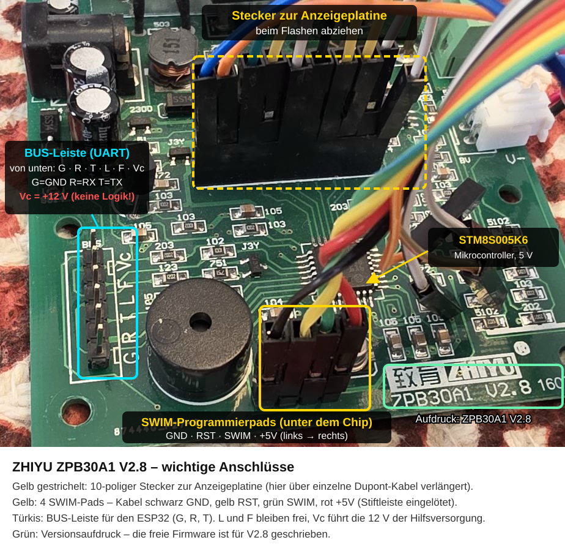

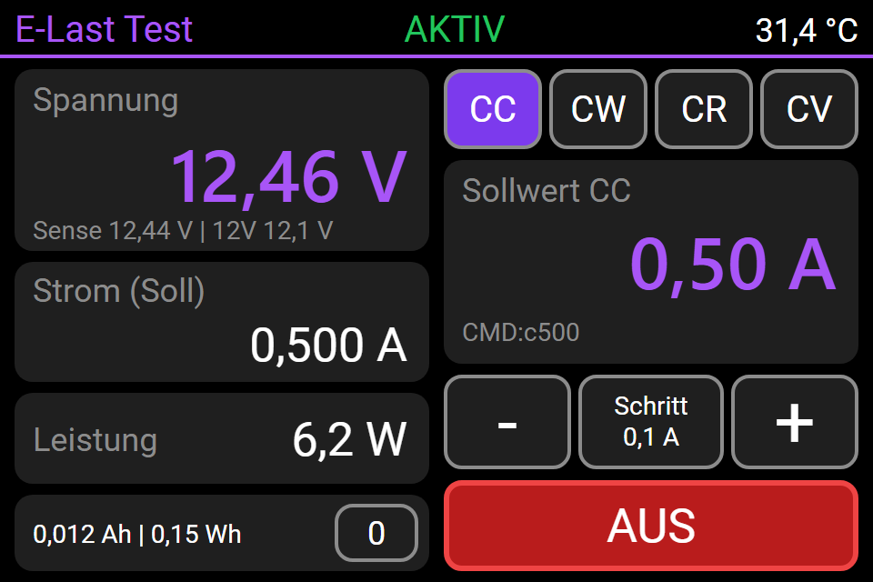

## Inhalt

1. [Funktionen](#funktionen)
2. [Teile und Hilfsmittel](#teile-und-hilfsmittel)
3. [Die Platine](#die-platine)
4. [Flashen Schritt für Schritt](#flashen-schritt-für-schritt)
5. [Erster Start und Kalibrierung](#erster-start-und-kalibrierung)
6. [Serielles Protokoll](#serielles-protokoll)
7. [Anschluss an den ESP32](#anschluss-an-den-esp32)
8. [ESPHome-Testgerät](#esphome-testgerät)
9. [Geplant: Akkutest, Rampentest, Protokoll](#geplant-akkutest-rampentest-protokoll)
10. [Fehlersuche](#fehlersuche)
11. [Offene Punkte](#offene-punkte)
12. [Dateien](#dateien)
13. [Quellen und Lizenz](#quellen-und-lizenz)

## Funktionen

**Mit der freien Firmware (an der Last selbst):**
- Betriebsarten **CC** (Konstantstrom), **CW** (Konstantleistung), **CR** (Konstantwiderstand), **CV** (Konstantspannung) – die Original-Firmware kann nur CC
- Abschaltspannung, Strombegrenzung und Verhalten bei Überleistung im Menü der Last
- Kalibrier-Assistent für den Strom (CAL → CURR)
- serielle Schnittstelle: Befehle hinein, alle 200 ms eine Messzeile heraus
- temperaturgeregelter Lüfter, Abschaltung bei Übertemperatur (85 °C)

**Testgerät `e-last-test` (Display):**
- Kopfzeile mit Status (AUS, AKTIV, NICHT GEREGELT, FEHLER …, OFFLINE) und Kühlkörpertemperatur
- Kacheln Spannung (mit Sense- und 12-V-Wert), Strom (Soll), Leistung, Ah/Wh mit Null-Taste
- Betriebsart CC / CW / CR / CV, Sollwert mit −/+ und umschaltbarer Schrittweite, Ein/Aus-Knopf
- letzte Antwort der Last (`CMD:…` / Fehlertext) direkt unter dem Sollwert
- Sicherheit: Verbindung weg oder neu da → das ESP schaltet die Last zuerst aus; Moduswechsel bei laufender Last schaltet ebenfalls erst aus
- Home Assistant: alle Messwerte, Status, Modus, Sollwert, Ein/Aus, Ah/Wh nullen, Rohzeilen zur Diagnose

## Teile und Hilfsmittel

| Teil | Hinweis | Link |
|---|---|---|
| Elektronische Last **ZHIYU ZPB30A1**, 60 W | **Platinenaufdruck V2.8** prüfen. Die 110-W-Variante und V3.x werden von der Firmware nicht unterstützt | [Amazon-Suche](https://www.amazon.de/s?k=ZHIYU+60W+elektronische+Last+9.99A+30V) |
| **ST-Link V2** (USB-Stick-Klon) | zum Flashen über SWIM. Belegung des eigenen Sticks am Aufdruck ablesen | [Amazon-Suche](https://www.amazon.de/s?k=ST-Link+V2) |
| 4 Dupont-Kabel + 4-polige Stiftleiste (2,54 mm) | Stiftleiste in die SWIM-Pads einlöten – sicherer als andrücken | – |
| 12-V-Netzteil, **potentialfrei**, ≥ 1 A | Hilfsversorgung der Last (Hohlbuchse) | – |
| Waveshare **ESP32-S3-Touch-LCD-3.5** | 480 × 320, Touch, PSRAM | [Amazon](https://www.amazon.de/dp/B0F3WS2W5R) · [Doku](https://docs.waveshare.com/ESP32-S3-Touch-LCD-3.5) |
| Widerstände 1 kΩ + 2 kΩ | Spannungsteiler 5 V → 3,3 V für den TX-Ausgang der Last (Testaufbau) | – |
| **ADuM1201**-Modul + 2 × 100 nF | galvanische Trennung im Endausbau (noch nicht verbaut) | [Amazon-Suche](https://www.amazon.de/s?k=ADuM1201+Modul) |
| Multimeter mit 10-A-Bereich | Kalibrierung des Stroms | – |
| Prüfquelle 12 V, ≥ 3,5 A | Kalibrierung (z. B. Akku oder Netzteil) | – |

**Software (Windows, kostenlos):**

| Programm | Wofür | Bezug |
|---|---|---|
| **STSW-LINK009** | USB-Treiber für den ST-Link | [st.com](https://www.st.com/en/development-tools/stsw-link009.html) (Login oder Gast-Download per Mail) |
| **STVP-STM8** (ST Visual Programmer, im „ST Toolset“) | Flashen über SWIM, Oberfläche + `STVP_CmdLine.exe` | [st.com](https://www.st.com/en/development-tools/stvp-stm8.html) |
| ESPHome Device Builder | Testgerät installieren | Home-Assistant-Add-on oder `pip install esphome` |
| optional: SDCC 4.5.0 | Firmware selbst bauen, siehe [firmware/BAUEN.md](firmware/BAUEN.md) | `winget install --id SDCC.SDCC -e` |

## Die Platine


| Anschluss | Lage | Belegung |
|---|---|---|
| **SWIM-Pads** | 4 Pads unter dem STM8, neben dem Quarz | links → rechts: **GND · RST · SWIM · +5V** |
| **BUS** (6-polig, links neben dem Summer) | serielle Schnittstelle | von unten nach oben: **G** (GND) · **R** (RX der Last) · **T** (TX der Last) · L · F · **Vc = +12 V** |
| 10-poliger Stecker | Verbindung zur Anzeigeplatine (7-Segment + Drehgeber) | beim Flashen abziehen |
| Hohlbuchse | 12-V-Hilfsversorgung der Elektronik | – |
| Schraubklemmen | Lasteingang + / − und Sense | – |

Wichtig:
- Der STM8 läuft mit **5 V**. Auch der T-Ausgang der BUS-Leiste hat 5-V-Pegel.
- **Vc an der BUS-Leiste führt +12 V** – das ist keine Logikspannung und darf nie an den ESP32.
- **G ist zugleich der Minus-Eingang der Last.** Siehe [Anschluss an den ESP32](#anschluss-an-den-esp32).

## Flashen Schritt für Schritt

> **Die Original-Firmware wird dabei unwiderruflich gelöscht.** Sie ist ausgelesen geschützt und kann vorher nicht gesichert werden.

### 1. Vorbereitung

1. **Anzeigeplatine abziehen** (10-poliger Stecker).
2. **Keine 12 V** an die Last, **nichts** an den Lasteingang. Der ST-Link versorgt den Chip mit 5 V.
3. 4-polige Stiftleiste in die SWIM-Pads einlöten (oder Kabel sehr sicher andrücken).
4. **STSW-LINK009** installieren (`dpinst_amd64.exe` ausführen), dann **STVP** (`sttoolset_pack42.exe`). Danach den ST-Link einmal ab- und anstecken. Im Geräte-Manager muss er ohne Warnsymbol erscheinen (USB-ID 0483:3748).

### 2. ST-Link verdrahten

**Entscheidend ist der Aufdruck auf dem eigenen Stick.** Anleitungen im Netz nummerieren die Pins teils anders. Bei diesem Klon liegen alle benötigten Signale in der **ungeraden Reihe**:

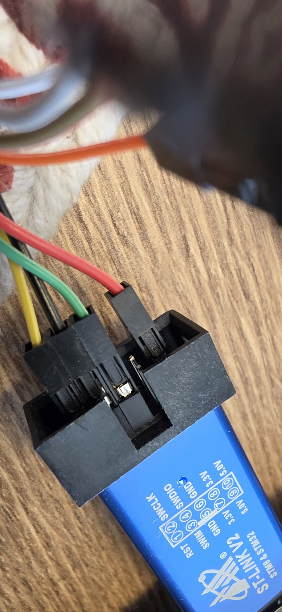

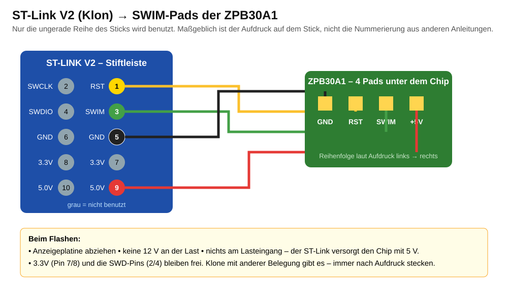

| Kabel | ZPB30A1 | ST-Link (Aufdruck) |
|---|---|---|
| gelb | RST | Pin 1 **RST** |
| grün | SWIM | Pin 3 **SWIM** |
| schwarz | GND | Pin 5 **GND** |
| rot | +5V | Pin 9 **5.0V** (nicht 3.3V an Pin 7!) |

So sah es beim Flashen aus (Anzeigeplatine hier über einzelne Kabel verlängert – zum Flashen abziehen):

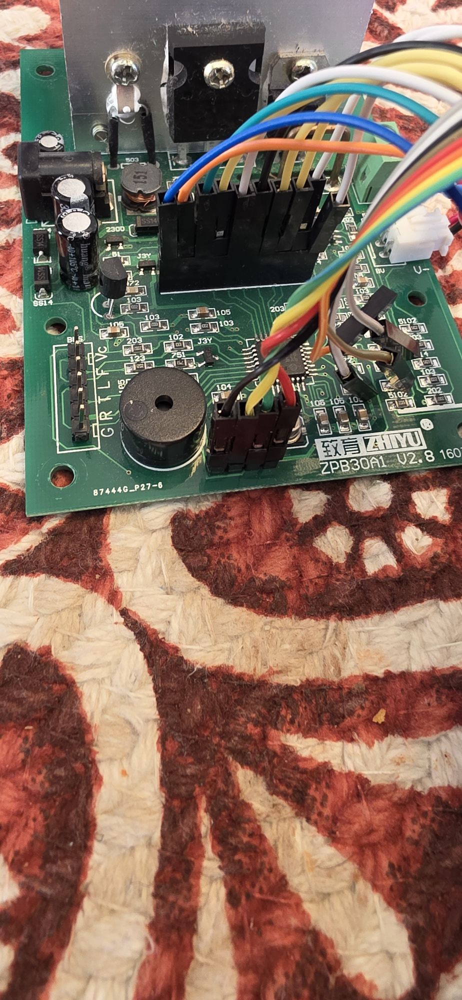

### 3. Lesetest

`werkzeuge/1_lesetest.cmd` ausführen. Das ändert nichts am Chip.

| Ausgabe | Bedeutung |
|---|---|
| `Cannot communicate with the device` | Verdrahtung falsch oder kein Kontakt → Aufdruck am Stick prüfen, 5 V an den Pads messen |
| `The device is protected` | **Richtig** – der Chip antwortet, die Original-Firmware ist geschützt |

### 4. Entsperren (löscht die Original-Firmware)

`werkzeuge/2_entsperren_original_loeschen.cmd` – fragt vorher nach. Schreibt `firmware/option_rop_off.hex` (Ausleseschutz aus). Der Chip löscht dabei Programm und EEPROM.

Oberfläche statt Skript: STVP → Configure: **ST-LINK, USB, SWIM, STM8S005K6** → Reiter **OPTION BYTE** → ROP = „Read Out Protection OFF“ → *Program → Current tab*.

### 5. Firmware und EEPROM schreiben

`werkzeuge/3_firmware_flashen.cmd` schreibt `firmware/electronic_load.hex` und `firmware/eeprom_leer.hex` und prüft beides. Erwartet: zweimal „successfully verified“.

Oberfläche: Reiter **PROGRAM MEMORY** → *File → Open* → `electronic_load.hex` → *Program → Current tab*; Reiter **DATA MEMORY** → alles 00 → *Program → Current tab*.

### 6. Option Bytes mit AFR7 = BEEP (wichtig!)

**Diese Falle hat uns einen Abend gekostet:** Nach Schritt 5 blieb die Last an 12 V **dunkel**. Ursache: `beeper_init()` der freien Firmware stellt das Option Byte AFR7 (Pin D4 = Piepser) beim Start selbst um, schreibt das Komplement-Byte aber nicht sauber. Der Chip erkennt kaputte Option Bytes und startet neu – endlos.

**Lösung:** Die Option Bytes einmal mit **OPT2 = 0x80 (AFR7 = „Port D4 Alternate Function = BEEP“)** schreiben. Dann muss die Firmware nichts mehr ändern.

So hat es funktioniert (STVP-Oberfläche):
1. Reiter **OPTION BYTE**. Beim Lesen kommt rot „Error on Option Bytes (complementary bytes)“ – das ist genau der Fehler.

   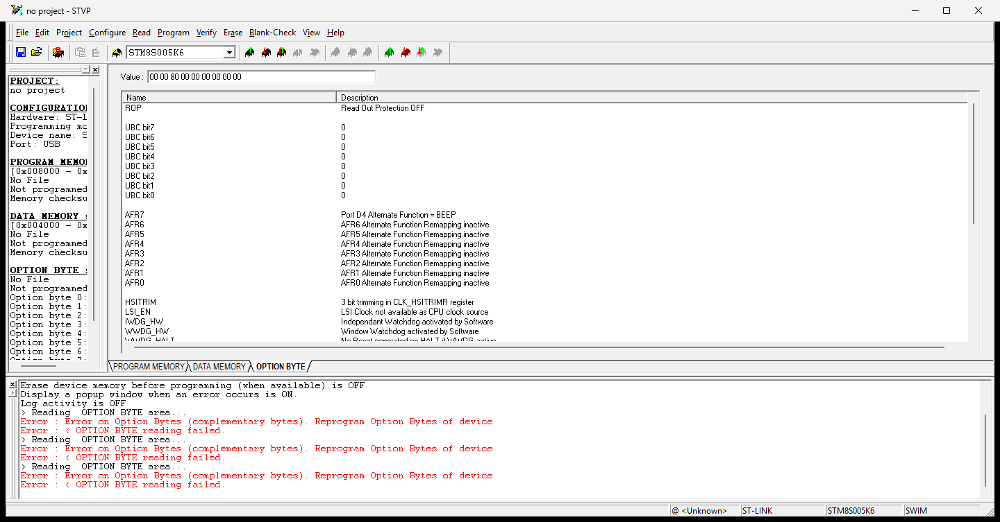

2. Die angezeigten Standardwerte stehen lassen: ROP = OFF, **AFR7 = BEEP**, alles andere Werkseinstellung (Wertezeile `00 00 80 00 00 00 00 00 00`).
3. *Program → Current tab* → „OPTION BYTE programming completed“ und **„OPTION BYTE successfully verified“**.

   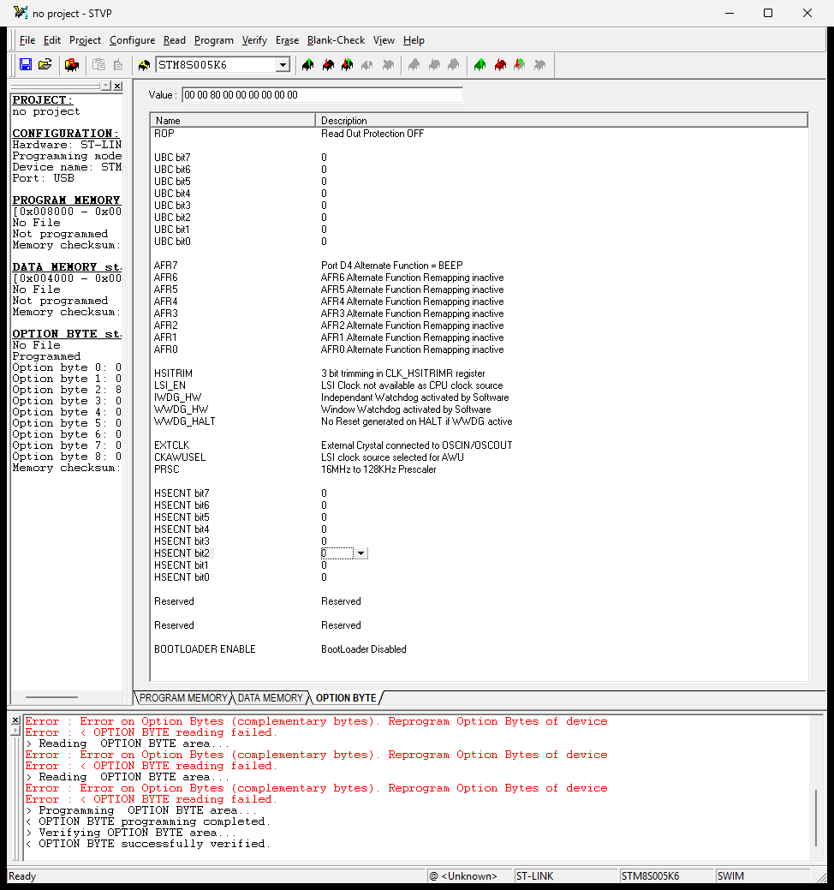

Kommandozeile (gleiche Werte): `werkzeuge/4_option_bytes_beep.cmd` mit `firmware/option_afr7.hex`. Bei uns hat zuverlässig die Oberfläche funktioniert.

> **Für diese Firmware die Option Bytes nie mit AFR7 = 0 schreiben** – sonst ist der Dauer-Reset wieder da.

### 7. Abschließen

ST-Link abziehen, Anzeigeplatine wieder aufstecken, 12 V anlegen. Die Anzeige zeigt das neue Menü (z. B. „rUn“).

## Erster Start und Kalibrierung

Ohne Kalibrierung weicht der Strom deutlich ab (typisch 650 mA statt 500 mA). Der Kalibrier-Assistent ist in der Firmware eingebaut:

1. Prüfquelle 12 V (≥ 3,5 A) über das Multimeter (10-A-Bereich, in Reihe) an den Lasteingang.
2. Menü → **CAL → CURR**.
3. Punkt LO (500 mA): **GO**, warten bis **RDY**, Multimeterwert eingeben.
4. Punkt HI (3000 mA): ebenso.
5. **OK / SAVE**, nochmal drücken → wird in einem eigenen Block im EEPROM gespeichert. `eeprom_leer.hex` löscht ihn mit – nach erneutem Flashen also neu kalibrieren.

Zurück auf Werkswerte: Menü → CAL → DEF. Abbruch: RUN-Taste oder 60 s nichts tun.

## Serielles Protokoll

Gilt für herm/ZPB30A1_Firmware, Stand `fe93bfe` (aus `software/uart.c` gelesen).

- **115200 Baud, 8N1, 5-V-Pegel**, BUS-Leiste: R = Eingang der Last, T = Ausgang der Last
- Befehl = Zeichen + evtl. Zahl + `\n`. Groß-/Kleinschreibung zählt.
- Der Parser startet **gesperrt** und nimmt erst nach einem `!` Befehle an → das ESP schickt vor jedem Befehl ein `!`.
- Befehle werden erst im Hauptprogramm ausgeführt → **100 ms Abstand** zwischen zwei Befehlen.

| Befehl | Wirkung | Bereich |
|---|---|---|
| `!` | Parser zurücksetzen | – |
| `R` | Last ein (Run) | – |
| `S` | Last aus (Stop) | – |
| `M0` … `M3` | Betriebsart CC / CW / CR / CV | 0–3 |
| `c<mA>` | Sollstrom | 200 … 10000 (`c1500` = 1,5 A) |
| `w<mW>` | Sollleistung | 1 … 60000 |
| `r<10 mΩ>` | Sollwiderstand | 10 … 15000 (`r1000` = 10 Ω) |
| `v<mV>` | Sollspannung | 500 … 30000 |
| `E` | Einstellungen ins EEPROM schreiben | – (beim ständigen Nachstellen **nicht** senden, EEPROM schonen) |
| `e` | Einstellungen aus dem EEPROM neu laden | – |

**Antworten:** `CMD:<Befehl><Zahl>` als Echo. Fehler: `ERR:<ASCII-Code des Befehls> <Zahl> <Code>` mit Code 1 = Modus ungültig, 2 = außerhalb des Bereichs, 3 = keine Ziffer, 5 = unbekannter Befehl. Beispiel `ERR:99 50 2` = `c50` zu klein. Achtung: Bei Code 3 wird der Befehl trotzdem mit dem bis dahin gelesenen Wert ausgeführt.

**Messzeile alle 200 ms:**

```
VAL: A 0 T 314 Vi 12034 Vl 12460 Vs 12440 I   500 mWs    1234567 mAs     45678
```

| Feld | Bedeutung |
|---|---|
| `D` / `A` / `U` | aus / aktiv und geregelt / aktiv, aber **nicht geregelt** (Quelle schafft den Strom nicht, Stromwert stimmt dann nicht) |
| Fehler 0–9 | 0 OK, 1 POL (verpolt), 2 OVP, 3 OVLD (Überlast), 4 PWR (> 65 W), 5 TEMP, 6 SUP (12 V zu niedrig), 7 TIME, 8 INT, 9 CMD |
| `T` | Temperatur in 0,1 °C |
| `Vi` / `Vl` / `Vs` | 12-V-Versorgung / Lastspannung / Sense-Spannung in mV |
| `I` | **Sollstrom** in mA – kein Messwert |
| `mWs` / `mAs` | Energie / Ladung seit dem Einschalten (aus dem Sollwert gerechnet, seriell nicht löschbar) |

**Nicht über die Schnittstelle einstellbar:** Abschaltspannung, Strombegrenzung, Piepser, Zähler löschen. Diese Aufgaben übernimmt das ESP (z. B. Abschaltspannung: `Vl` zu klein → `S`; Ah/Wh als Differenz ab Teststart).

## Anschluss an den ESP32

### Testaufbau (so läuft `e-last-test`)

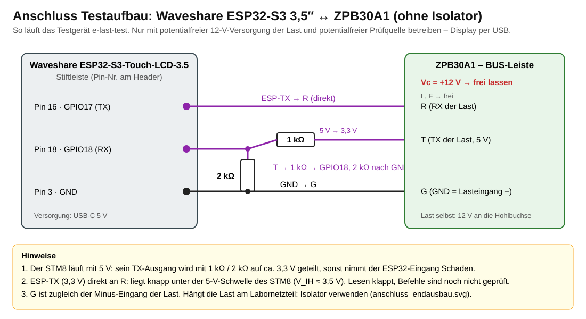

| Waveshare (Leisten-Pin) | Verbindung | ZPB30A1 BUS |
|---|---|---|
| Pin 16 · GPIO17 (TX) | direkt | **R** |
| Pin 18 · GPIO18 (RX) | über 1 kΩ, 2 kΩ von GPIO18 nach GND | **T** |
| Pin 3 · GND | direkt | **G** |
| – | frei lassen | L, F, **Vc (+12 V)** |

- Display per USB-C versorgen, Last mit eigenem **potentialfreiem** 12-V-Netzteil.
- Der Teiler bringt die 5 V vom T-Ausgang auf ca. 3,3 V – ohne ihn nimmt der ESP32 Schaden.
- Die 3,3 V vom ESP an R liegen knapp unter der Schaltschwelle des 5-V-STM8 (≈ 3,5 V). **Lesen funktioniert, ob Befehle sicher ankommen, ist noch nicht geprüft.** Sonst hilft ein Pegelwandler bzw. gleich der ADuM1201.

### Endausbau (geplant): galvanisch getrennt

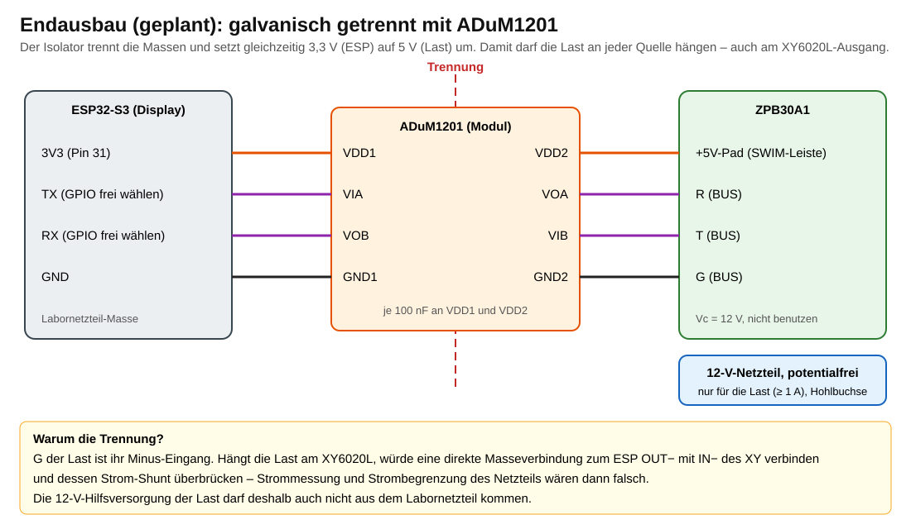

- ADuM1201: Seite 1 am ESP (3,3 V, GND, TX → VIA, VOB → RX), Seite 2 an der Last (5 V vom +5V-Pad, G, VOA → R, T → VIB), je 100 nF an VDD1/VDD2.
- Der Isolator setzt die Pegel gleich mit um (3,3 V ↔ 5 V).
- **Warum:** G ist der Minus-Eingang der Last. Hängt die Last am Ausgang des Labornetzteils (XY6020L), würde eine direkte Masseverbindung OUT− mit IN− verbinden und den Strom-Shunt des XY überbrücken.
- Die 12-V-Hilfsversorgung der Last darf deshalb auch nicht aus dem Labornetzteil kommen.

## ESPHome-Testgerät

Dateien: [`esphome/e-last-test.yaml`](esphome/e-last-test.yaml) und [`esphome/e-last-test/el.h`](esphome/e-last-test/el.h) (Zeilen-Parser, Sende-Warteschlange, Formatierung).

1. Beide Dateien in den ESPHome-Ordner kopieren (`el.h` in den Unterordner `e-last-test/`).
2. `secrets.yaml` ergänzen – Vorlage: [`esphome/secrets.yaml.example`](esphome/secrets.yaml.example).
3. Im Device Builder installieren (erstes Mal per USB, danach OTA).

**Bedienung:**


| Element | Funktion |
|---|---|
| CC / CW / CR / CV | Betriebsart wählen (läuft die Last, wird sie vorher ausgeschaltet) |
| − / + | Sollwert ändern, gedrückt halten = wiederholen. Gesendet wird 300 ms nach dem letzten Tipp |
| Schritt | Schrittweite umschalten (grob / mittel / fein, z. B. 1 / 0,1 / 0,01 A) |
| EIN / AUS | Last ein- und ausschalten; grau „offline“, wenn keine Messzeilen kommen |
| 0 | Ah/Wh auf null setzen (das ESP merkt sich den Startwert) |
| Kopfzeile | Status in Farbe: grau AUS, grün AKTIV, orange NICHT GEREGELT, rot FEHLER/OFFLINE |
| Zeile unter dem Sollwert | letzte Antwort der Last (`CMD:c500`) oder Fehlertext („12 V zu niedrig“ …) |

**In Home Assistant:** Spannung Last, Spannung Sense, Versorgung 12V, Strom Soll, Leistung, Temperatur, Ladung, Energie, Status, Modus, Sollwert, Schalter „Last“, Taste „Ah/Wh nullen“ sowie die Rohzeilen (letzte Antwort, letzte VAL-Zeile, sonstige Zeile) zur Fehlersuche.

**Technik in Kürze:**
- `el::lies()` liest alle 20 ms den UART, filtert Störbytes nach dem Einschalten (nur druckbares ASCII, alles vor `VAL:`/`CMD:`/`ERR:` wird verworfen) und zerlegt die Zeilen. Ohne diesen Filter trennte Home Assistant die API-Verbindung („bad UTF-8“).
- `el::sende()` schickt alle 100 ms höchstens einen Befehl, immer mit `!` davor.
- „Online“ = in den letzten 1,5 s kam eine Messzeile.

## Geplant: Akkutest, Rampentest, Protokoll

Diese Ansichten sind **Entwürfe** für den Einbau ins Labornetzteil (Farbe Violett = E-Last, Cyan = Netzteil). Umschalten per langem Druck auf Drehgeber 2: Netzteil → E-Last → Kombi.

| | |
|---|---|
| 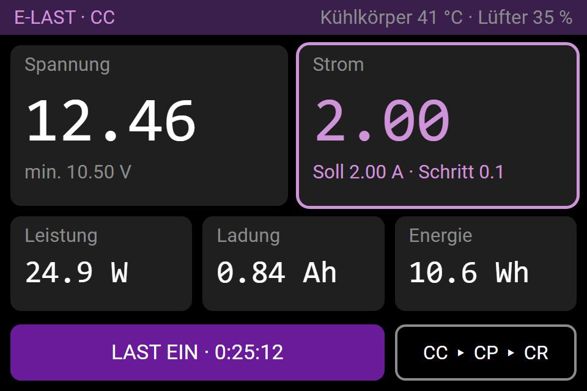 **E1 Hauptansicht** – Spannung mit Abschaltgrenze, Sollwert am Drehgeber, Leistung, Ah, Wh, Laufzeit | 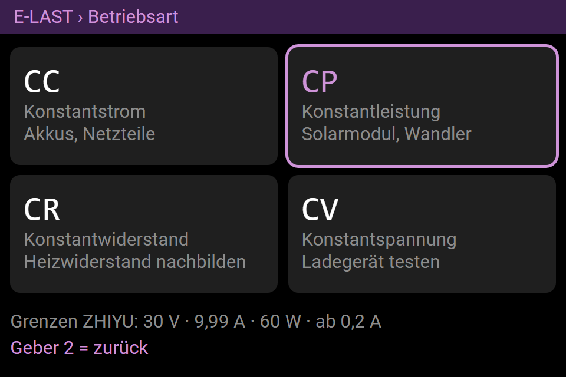 **E2 Betriebsart** – CC / CP / CR / CV mit Einsatzbeispiel und den Grenzen der Last |
| 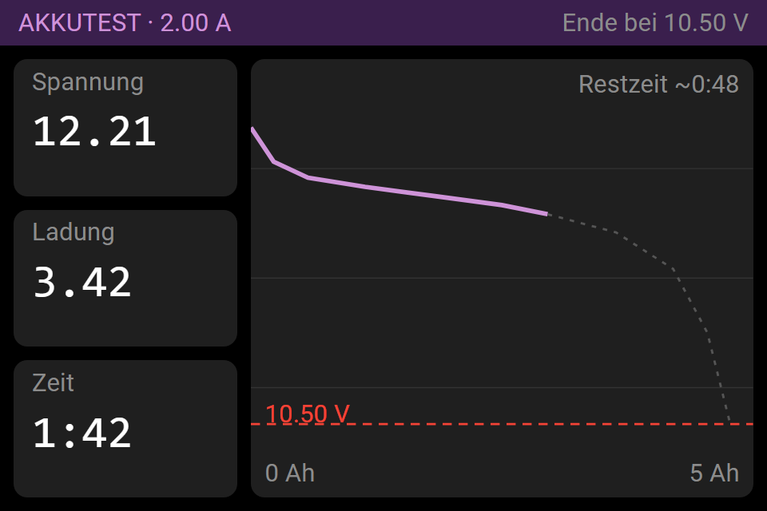 **E3 Akkutest** – Entladekurve U über Ah, rote Abschaltlinie, geschätzte Restzeit | 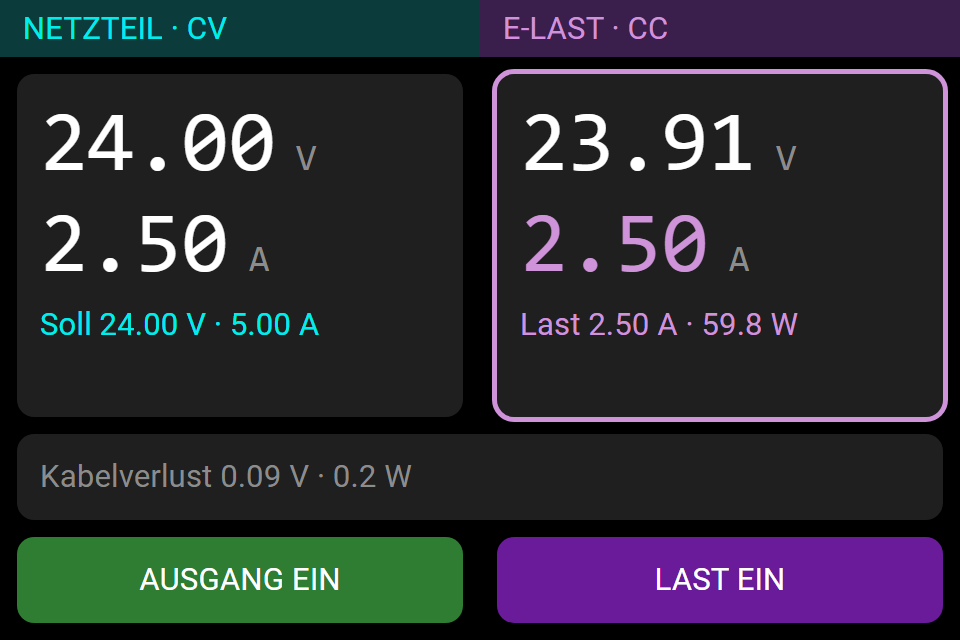 **E4 Kombi** – Netzteil speist Last, beide Seiten nebeneinander, Kabelverlust aus der Spannungsdifferenz |

### Rampentest

Die Last steigt in Schritten, bis die Quelle einbricht – dann sofort Stopp und Auswertung.

| | | |
|---|---|---|
| 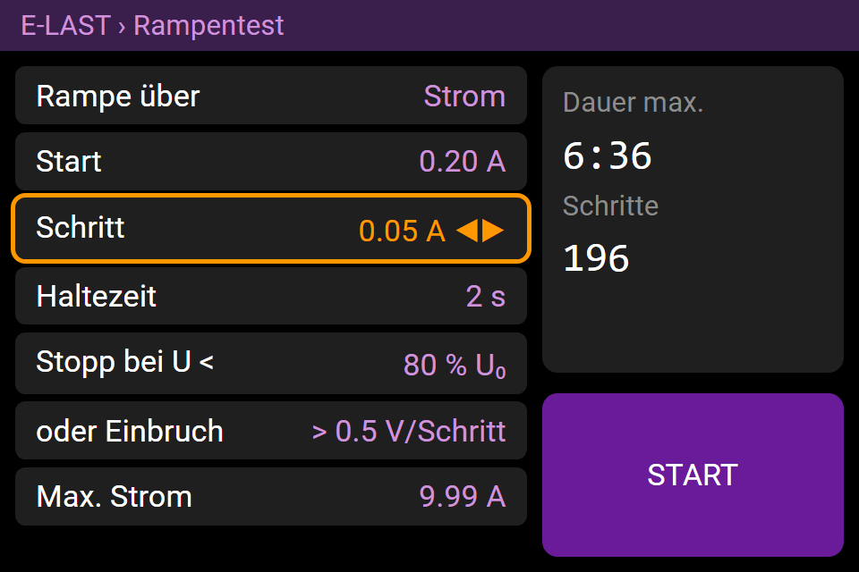 **R1 Einstellen** | 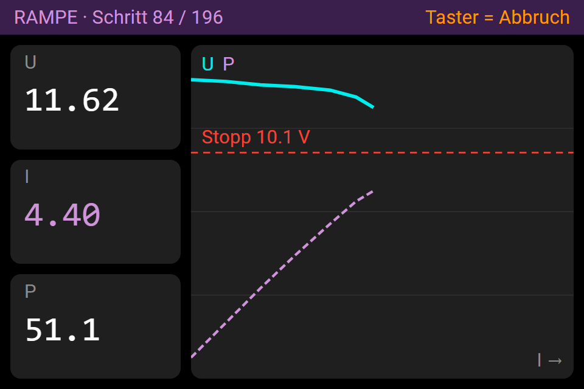 **R2 Test läuft** | 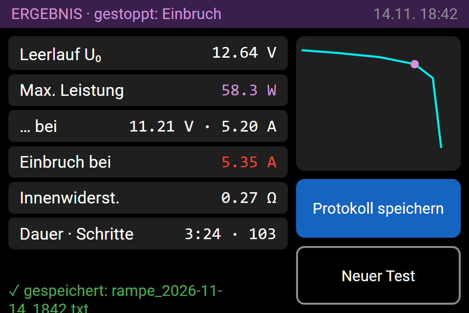 **R3 Ergebnis** |

1. Leerlaufspannung U₀ messen (Last aus, Mittel aus 5 Messzeilen).
2. Rampe über **Strom** (CC) oder **Leistung** (CW): Start, Schritt, Haltezeit, Maximum (≤ 9,99 A / 60 W).
3. Pro Schritt: Sollwert senden, Haltezeit warten, Mittel der letzten 3 Messzeilen speichern (max. ca. 200 Punkte).
4. **Stopp** bei: U unter festem Wert oder unter x % von U₀, Einbruch größer X V pro Schritt, Status „nicht geregelt“, Fehler der Last, Maximum erreicht, Taster, Verbindung weg → sofort `S`.
5. **Ergebnis:** U₀, maximale Leistung mit U und I, Einbruchstrom, Innenwiderstand (Ausgleichsgerade U(I) über alle geregelten Punkte), Dauer, Ah/Wh.

### Protokoll an Home Assistant

„Protokoll speichern“ schickt ein Ereignis `esphome.labornetzteil_protokoll` mit Zusammenfassung und Messtabelle (Semikolon-CSV). Eine Automation schreibt daraus eine Textdatei, z. B. `/share/labornetzteil/rampe_2026-11-14_1842.txt` – über die Samba-Freigabe direkt am PC lesbar und in Excel zu öffnen. Der Name des Prüflings kommt aus einem Text-Helfer in Home Assistant.

```text
RAMPENTEST  Labornetzteil / E-Last ZHIYU
Datum        2026-11-14 18:42:07
Prüfling     Akku Werkzeug 18 V Nr. 2
Einstellung  Rampe Strom 0.20 A + 0.05 A / 2 s, Stopp U < 80 % U0 oder Einbruch > 0.5 V
Stoppgrund   Einbruch bei Schritt 103

ERGEBNIS
Leerlaufspannung U0     12.64 V
Max. Leistung           58.3 W  bei 11.21 V / 5.20 A
Einbruch bei            5.35 A  (U fiel 11.18 V -> 9.84 V)
Innenwiderstand         0.27 Ohm
Dauer                   3:24 min, 103 Schritte, 0.12 Ah, 1.46 Wh

MESSWERTE
Schritt;Zeit_s;I_A;U_V;P_W
1;2;0.20;12.58;2.52
...
```

## Fehlersuche

| Problem | Ursache / Lösung |
|---|---|
| STVP: „Cannot communicate with the device“ | Verdrahtung. Pins nach **Aufdruck am Stick** stecken (bei diesem Klon 1 RST, 3 SWIM, 5 GND, 9 5.0V). 5 V zwischen GND- und +5V-Pad messen. Anzeigeplatine ab, keine 12 V |
| ST-Link im Geräte-Manager mit Fehler | Treiber STSW-LINK009 fehlt; danach Stick neu anstecken |
| „The device is protected“ | Normal vor dem Entsperren (Schritt 4) |
| „Error on Option Bytes (complementary bytes)“ | Kommt nach dem Entsperren und bei der Firmware-Falle. Option Bytes in der STVP-Oberfläche mit AFR7 = BEEP schreiben (Schritt 6) |
| Last bleibt an 12 V dunkel | Dauer-Reset wegen AFR7 → Schritt 6 |
| PowerShell zerlegt `-FileProg=…` | Argumente von `STVP_CmdLine.exe` in einfache Anführungszeichen setzen oder die `.cmd`-Skripte nutzen |
| Fehler **SUP** an der Last | 12-V-Hilfsversorgung zu schwach oder Wackelkontakt |
| Status **NICHT GEREGELT** / `U` | Quelle liefert den eingestellten Strom nicht (Spannung zu klein); angezeigter Strom stimmt dann nicht |
| Display zeigt **OFFLINE** | keine Messzeile seit 1,5 s: T → Teiler → GPIO18 und GND prüfen, Last an 12 V? |
| Home Assistant verliert die Verbindung („bad UTF-8“) | alte `el.h` ohne Störbyte-Filter → aktuelle Version aus diesem Ordner verwenden |
| Befehle kommen nicht an (keine `CMD:`-Zeile) | 3,3 V reichen dem STM8 nicht sicher → Pegelwandler oder ADuM1201 |

## Offene Punkte

- [ ] Befehle vom Display prüfen: Ein/Aus, Sollwert, Betriebsart (Antwortzeile `CMD:`)
- [ ] Kalibrierung CAL → CURR durchführen
- [ ] Endausbau mit ADuM1201 und potentialfreier 12-V-Versorgung
- [ ] Testgerät dauerhaft in Home Assistant einbinden
- [ ] Einbau ins [Labornetzteil](../Labornetzteil-XY6020L): zweiter UART (GPIO-Umbau mit I²C-Expander), Modus E-Last, Akkutest, Rampentest, Protokoll-Automation

## Dateien

```
E-Last-ZHIYU-ESP32/
├── README.md
├── docs/
│   ├── platine_anschluesse.svg      Foto der Platine mit beschrifteten Anschlüssen
│   ├── foto_platine_v28.jpg         Platine beim Flashen (SWIM-Kabel, Version V2.8)
│   ├── foto_stlink_klon.jpg         Aufdruck/Belegung des ST-Link-Klons
│   ├── stlink_verdrahtung.svg       ST-Link → SWIM-Pads
│   ├── stvp_option_byte_fehler.png  STVP: Fehler „complementary bytes“
│   ├── stvp_option_byte_ok.png      STVP: Option Bytes erfolgreich geschrieben
│   ├── anschluss_test.svg           ESP32 ↔ Last, Testaufbau mit Spannungsteiler
│   ├── anschluss_endausbau.svg      ESP32 ↔ Last mit ADuM1201 (geplant)
│   └── display_0*.png               Testseite und geplante Ansichten
├── firmware/
│   ├── electronic_load.hex          freie Firmware (herm, fe93bfe), fertig zum Flashen
│   ├── option_rop_off.hex           Option Bytes: Ausleseschutz aus
│   ├── option_afr7.hex              Option Bytes: AFR7 = BEEP (gegen Dauer-Reset)
│   ├── eeprom_leer.hex              EEPROM leeren
│   ├── BAUEN.md                     Firmware selbst bauen (SDCC)
│   └── LICENSE-herm-GPL-3.0.txt
├── werkzeuge/
│   ├── 1_lesetest.cmd
│   ├── 2_entsperren_original_loeschen.cmd
│   ├── 3_firmware_flashen.cmd
│   └── 4_option_bytes_beep.cmd
└── esphome/
    ├── e-last-test.yaml
    ├── e-last-test/el.h
    └── secrets.yaml.example
```

## Quellen und Lizenz

- Freie Firmware: [herm/ZPB30A1_Firmware](https://github.com/herm/ZPB30A1_Firmware) (GPL-3.0) – Fork von Benik3 / ArduinoHannover. `firmware/electronic_load.hex` ist ein unverändertes Kompilat von Commit `fe93bfe`; Quelltext und Lizenz siehe Link und `firmware/LICENSE-herm-GPL-3.0.txt`.
- Flash-Anleitung im Netz: [Gist von dirksan28](https://gist.github.com/dirksan28/4671db81ac1009e13b50d0cd0259570e) (Achtung: andere ST-Link-Nummerierung als hier).
- Teardown mit erstem Fund der seriellen Schnittstelle: [Blog „Whatever“](https://whatever.sdfa3.org/zpb30a1-electronic-load.html).
- Hintergrund: [Hackaday: ZPB30A1 Electronic Load Gets An Open Firmware](https://hackaday.com/2018/09/06/zpb30a1-electronic-load-gets-an-open-firmware).
- Eigene Dateien (ESPHome, Zeichnungen, Skripte): frei verwendbar für private Projekte.
