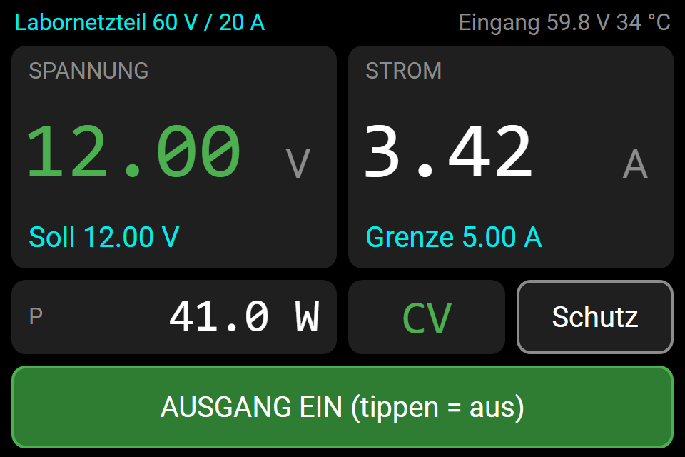
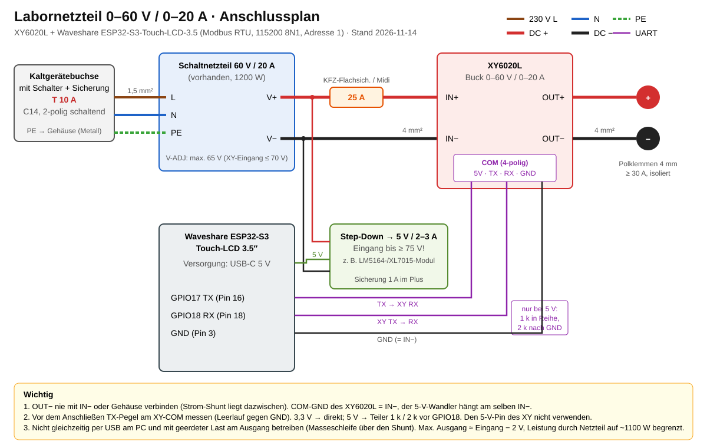
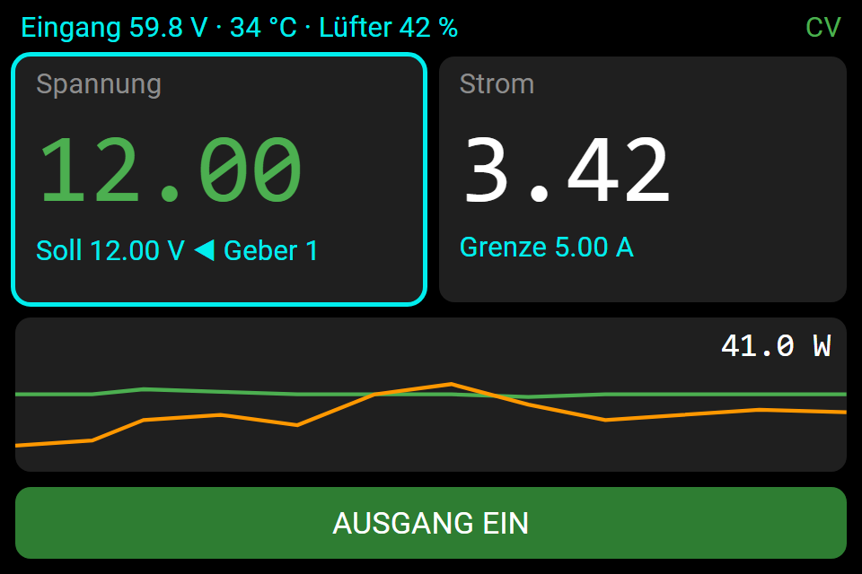
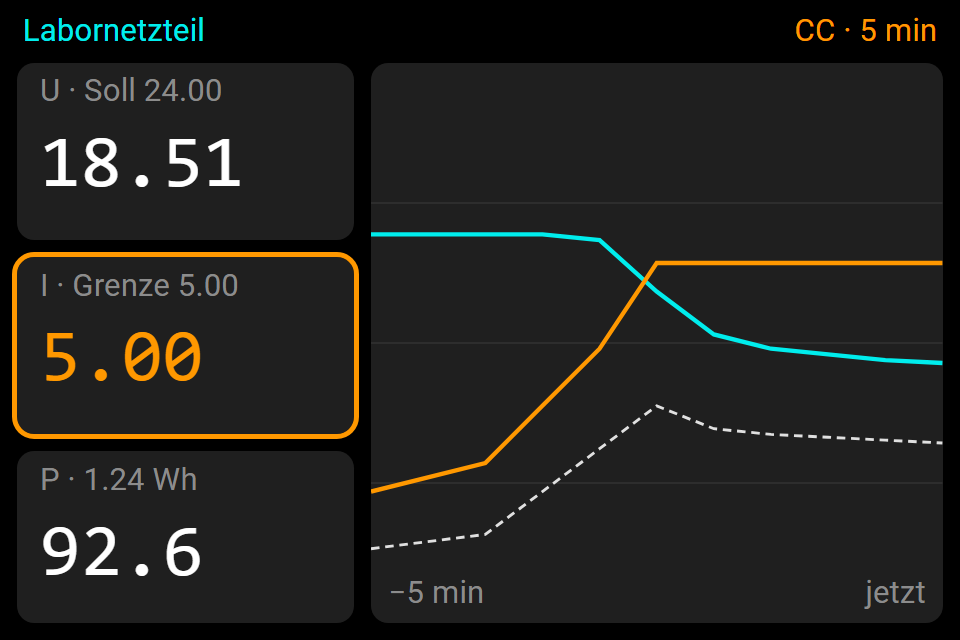
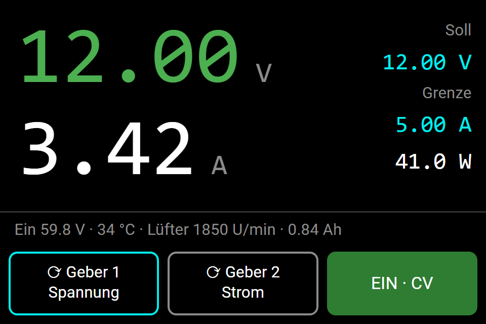
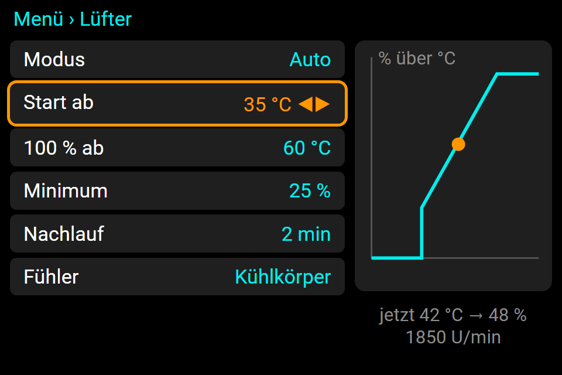

# Labornetzteil 0–60 V / 0–20 A mit XY6020L und ESP32-Touch-Display

Ein Labornetzteil aus einem fertigen 60-V/20-A-Schaltnetzteil und dem Abwärtswandler **XY6020L**. Bedient wird es über ein **Waveshare ESP32-S3-Touch-LCD-3.5** mit ESPHome, das den XY6020L per **Modbus RTU** steuert – mit großen Anzeigen, Schutzgrenzen und Anbindung an Home Assistant.

> **Stand 22.11.2026 – Entwurf, noch nicht aufgebaut:**
> - ESPHome-Konfiguration **Version 1** (nur Touch-Bedienung) ist geschrieben, aber **noch nie kompiliert oder installiert**.
> - Hardware noch nicht aufgebaut; Pegel und Pinfolge am COM-Stecker des XY6020L noch nicht gemessen.
> - Drehgeber, Ausgangstaster, Lüfterregelung und Verlaufsgraph sind **geplant** (Entwürfe unten), aber noch nicht programmiert.
> - Die elektronische Last für Akku- und Netzteiltests ist als eigenes Projekt schon weiter: [E-Last-ZHIYU-ESP32](../E-Last-ZHIYU-ESP32).



## Inhalt

1. [Aufbau](#aufbau)
2. [Teile](#teile)
3. [Anschlussplan](#anschlussplan)
4. [XY6020L per Modbus](#xy6020l-per-modbus)
5. [ESPHome Version 1](#esphome-version-1)
6. [Geplant: Drehgeber, Lüfter, Graph](#geplant-drehgeber-lüfter-graph)
7. [Sicherheit](#sicherheit)
8. [Offene Punkte](#offene-punkte)
9. [Dateien](#dateien)

## Aufbau

```
230 V ─► Kaltgerätebuchse (Schalter, T 10 A) ─► Schaltnetzteil 60 V / 20 A
                                                    │
                                     ┌── 25 A ──────┤
                                     ▼              ▼
                                 XY6020L        Step-down ≥ 75 V Eingang → 5 V
                              (0–60 V, 0–20 A)          │
                                     │                  ▼
                               Polklemmen        Waveshare ESP32-S3 3,5″ ◄── Modbus (UART) ── XY6020L COM
```

- Am Ausgang sind mit 60 V Eingang etwa **57–58 V** möglich (der XY braucht etwas Spannungsabfall).
- Die Leistung ist durch das Netzteil auf rund **1100 W** begrenzt (XY6020L max. 1200 W).
- Der XY6020L verträgt am Eingang **höchstens 70 V** – ein einstellbares Netzteil nie höher als 65 V stellen.

## Teile

| Teil | Hinweis |
|---|---|
| Schaltnetzteil 60 V / 20 A (1200 W) | vorhanden |
| **XY6020L** | 0–60 V, 0–20 A, 1200 W, Modbus über TTL-COM-Stecker, eigener Lüfter |
| Waveshare **ESP32-S3-Touch-LCD-3.5** | [Amazon](https://www.amazon.de/dp/B0F3WS2W5R) · [Doku](https://docs.waveshare.com/ESP32-S3-Touch-LCD-3.5) |
| Step-down → 5 V / 2–3 A, **Eingang bis ≥ 75 V** | z. B. LM5164- oder XL7015-Modul, 1-A-Sicherung im Plus; versorgt das Display über USB-C |
| Kaltgerätebuchse mit Schalter und Sicherung T 10 A | Netzseite 1,5 mm² |
| Sicherung 25 A (KFZ-Flachsicherung oder Midi) | zwischen Netzteil und XY6020L |
| 4-mm-Polklemmen, isoliert, ≥ 30 A | Ausgang |
| Silikonlitze 4 mm² rot/schwarz | alle DC-Leitungen, kurz halten |
| 1 kΩ + 2 kΩ | nur falls der TX-Ausgang des XY 5 V führt (Spannungsteiler vor GPIO18) |
| Metallgehäuse, geerdet | Lüftungswege für Netzteil und XY freihalten |
| *geplant:* 2 × Drehgeber EC11 mit Taster, Taster mit LED-Ring, 12-V-PWM-Lüfter + Step-down 12 V, NPN-Transistor | siehe [Geplant](#geplant-drehgeber-lüfter-graph) |

## Anschlussplan



| Waveshare (Leisten-Pin) | XY6020L COM |
|---|---|
| Pin 16 · GPIO17 (TX) | RX |
| Pin 18 · GPIO18 (RX) | TX (bei 5-V-Pegel über 1 kΩ, 2 kΩ nach GND) |
| Pin 3 · GND | GND |
| – | 5V am XY **nicht** verwenden – das Display bekommt einen eigenen Wandler |

**Vor dem Anschließen messen:** TX am COM-Stecker gegen GND im Leerlauf. 3,3 V → direkt; 5 V → Teiler. Die Pinfolge des COM-Steckers mit dem Aufdruck vergleichen (in einem Forenbeitrag: 5V · TX · RX · GND).

## XY6020L per Modbus

Modbus RTU, **115200 8N1, Slave-Adresse 1**, Funktion 0x03 (lesen) und 0x06 (schreiben). Alle Register 16 Bit.

| Register | Inhalt | Faktor |
|---|---|---|
| 0x00 | Sollspannung V-SET | ÷ 100 V |
| 0x01 | Stromgrenze I-SET | ÷ 100 A |
| 0x02 | Ausgangsspannung | ÷ 100 V |
| 0x03 | Ausgangsstrom | ÷ 100 A |
| 0x04 | Ausgangsleistung | ÷ 10 W |
| 0x05 | Eingangsspannung | ÷ 100 V |
| 0x06 / 0x07 | Ladung (32 Bit, unteres Wort zuerst) | ÷ 1000 Ah |
| 0x08 / 0x09 | Energie (32 Bit, unteres Wort zuerst) | ÷ 1000 Wh |
| 0x0A–0x0C | Einschaltzeit h / min / s | – |
| 0x0D / 0x0E | Temperatur intern / extern | ÷ 10 °C |
| 0x0F | Tastensperre (0/1) | – |
| 0x10 | ausgelöster Schutz (0 schreiben = quittieren) | – |
| 0x11 | Regelmodus 0 = CV, 1 = CC | – |
| 0x12 | Ausgang 0 = aus, 1 = ein | – |
| 0x16 / 0x17 | Modell / Firmware | – |
| 0x52 | Schutz Unterspannung Eingang (LVP) | ÷ 100 V |
| 0x53 | Schutz Überspannung (OVP) | ÷ 100 V |
| 0x54 | Schutz Überstrom (OCP) | ÷ 100 A |
| 0x55 | Schutz Überleistung (OPP) | ÷ 10 W |

Quelle: Registertabelle der Rust-Bibliothek [xy-modbus](https://docs.rs/crate/xy-modbus/0.1.1/source/src/regs.rs) (am XY7025 getestet, gleiche Belegung) und [Jens3382/xy6020l](https://github.com/Jens3382/xy6020l). Am eigenen XY6020L noch nicht geprüft.

## ESPHome Version 1

Datei: [`esphome/labornetzteil.yaml`](esphome/labornetzteil.yaml) (Gerät `labornetzteil`), Secrets-Vorlage [`esphome/secrets.yaml.example`](esphome/secrets.yaml.example). Display-Grundlage (mipi_spi, Touch, LVGL-Einstellungen) wie beim Heizungs-Display und der T12-Station.

**Hauptseite** (siehe Bild oben):
- große Ziffern für Spannung und Strom mit fester Zeichenbreite (Roboto Mono), darunter Soll- und Grenzwert
- Leistung, Anzeige **CV / CC / AUS** – der gerade begrenzende Wert wird farbig
- Kopfzeile mit Eingangsspannung und Temperatur oder „XY6020L: keine Verbindung“
- **Ausgang:** einschalten nur mit **langem Druck (0,8 s)**, ausschalten mit kurzem Tippen
- rotes Band bei Schutzabschaltung mit Grund (OVP, OCP, OPP, LVP …) und Knopf „Quittieren“
- nach 2 min ohne Berührung auf 25 % gedimmt

**Einstellseite** (Antippen der Spannungs- oder Stromkachel): Schrittweite 10 / 1 / 0,1 / 0,01, −/+ mit Wiederholung, Schnellwahl 3,3 / 5 / 12 / 24 / 48 / 55 V bzw. 0,5 / 1 / 2 / 5 / 10 / 20 A. Geänderte Werte sind orange, erst „Übernehmen“ sendet sie.

**Schutz-Seite:** Überspannung, Überstrom, Überleistung, Eingang min. mit −/+ und „Speichern“; Info zu Ah, Wh, Laufzeit, Temperaturen, Modell/Firmware; Tastensperre am XY.

**Home Assistant:** alle Messwerte, Soll- und Schutzwerte als Zahlen, Schalter Ausgang und Tastensperre, Verbindungsstatus.

## Geplant: Drehgeber, Lüfter, Graph

Gewählt ist das Layout **A** als Startseite, **B** als Graph-Vollbild und **D** als Menü. **C** war die kompakte Alternative.

| | |
|---|---|
|  **A Klassisch** – große Ziffern, kleine Verlaufskurve, Rahmen zeigt den aktiven Drehgeber |  **B Graph** – U, I, P über 2 / 10 / 30 min |
|  **C Kompakt** (Alternative) – beide Geber sichtbar, Statusleiste |  **D Menü Lüfter** – Lüfterkurve, mit Geber 1 blättern |

**Bedienkonzept:**
- **Geber 1** = Spannung, **Geber 2** = Strom; Wert geht 0,3 s nach dem letzten Dreh an den XY
- kurz drücken = Schrittweite 1 → 0,1 → 0,01; lang drücken: Geber 1 = Menü, Geber 2 = Geber sperren bzw. Modus wechseln (Netzteil → [E-Last](../E-Last-ZHIYU-ESP32) → Kombi)
- eigener **Taster mit LED-Ring** für den Ausgang (Einschalten mit 0,5 s Druck)
- **Lüfter** 12 V PWM (25 kHz) nach der Temperatur des XY (externer Fühler über Register 0x0E), Kurve, Minimum, Nachlauf im Menü
- **Graph** mit LVGL-Linien und Ringspeicher (1 Wert/s, 30 min)

**Pinplan (Waveshare-Stiftleiste):**

| Funktion | GPIO (Leisten-Pin) |
|---|---|
| Modbus TX / RX | 17 (16) / 18 (18) |
| Geber 1 A / B / Taster | 39 (9) / 40 (11) / 41 (13) |
| Geber 2 A / B / Taster | 42 (15) / 47 (21) / 48 (23) |
| Ausgangstaster | 21 (5) |
| LED im Taster | 38 (7) |
| Lüfter PWM / Tacho | 10 (12) / 11 (10) – dann keine SD-Karte |

Damit ist die Leiste voll. Für den zweiten UART zur E-Last wandern die Taster und die LED auf einen I²C-Port-Expander (PCF8574 an 0x21; 0x20 ist der PCA9554 des Displays).

**Weitere Idee (verworfen/offen):** ein zweiter Ausgang mit der vollen Netzteilspannung. Ein normales SSR für 230 V (AC-Typ) schaltet Gleichstrom **nicht** ab – dafür bräuchte es ein MOSFET-Modul oder ein DC-Schütz mit Vorladung.

## Sicherheit

- **OUT− nie mit IN− oder dem Gehäuse verbinden** – dazwischen liegt der Strom-Shunt des XY6020L. Die COM-Masse des XY ist IN−.
- Das Display nicht per USB am PC lassen, solange eine geerdete Last am Ausgang hängt (Masseschleife über den Shunt).
- Netzteil-Gehäuse und Metallgehäuse an PE, DC-Seite potentialfrei.
- Ausgang einschalten nur mit langem Druck; nach einem Neustart bleibt der Ausgang, wie der XY ihn hat (Einschaltverhalten im XY-Menü auf „aus“ lassen).

## Offene Punkte

- [ ] YAML im Device Builder kompilieren (ungeprüft: Schreibweise der Schrift `Roboto Mono`, einige LVGL-Optionen)
- [ ] TX-Pegel und Pinfolge am COM-Stecker messen
- [ ] Register am eigenen XY6020L prüfen; ob neue Schutzgrenzen (0x52–0x55) sofort wirken
- [ ] Hardware aufbauen
- [ ] Version 2: Drehgeber, Taster, Lüfter, Graph, Moduswechsel zur E-Last

## Dateien

```
Labornetzteil-XY6020L/
├── README.md
├── docs/
│   ├── anschlussplan.svg            Netz, Netzteil, XY6020L, 5-V-Wandler, UART
│   ├── display_01-v1-hauptseite.png Hauptseite Version 1 (in der YAML)
│   └── display_02…05-*.png          geplante Layouts A–D
└── esphome/
    ├── labornetzteil.yaml           Version 1, Touch-Bedienung (ungetestet)
    └── secrets.yaml.example
```
