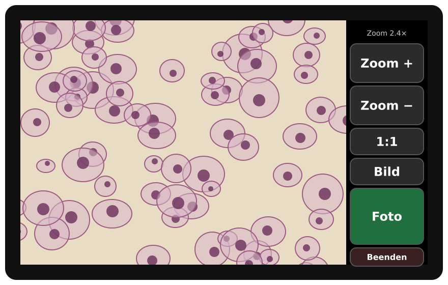
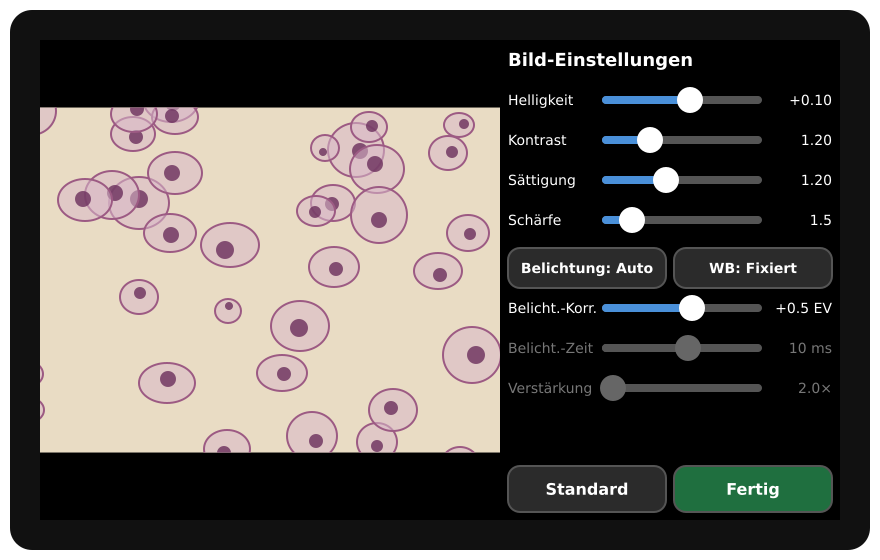
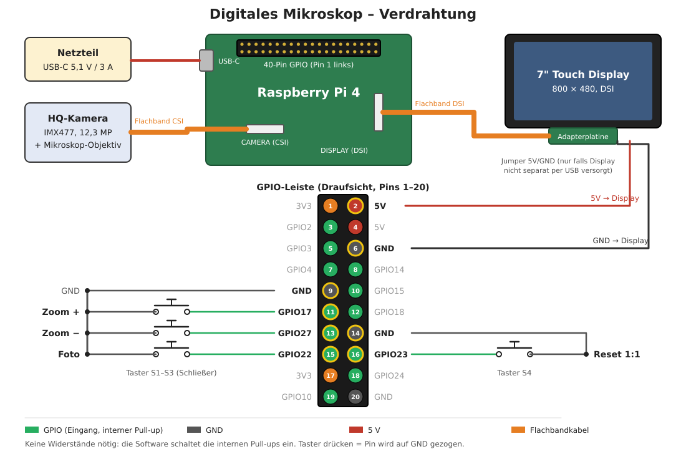

# Digitales Mikroskop

Raspberry Pi 4 + Raspberry Pi HQ-Kamera + offizielles 7"-Touchdisplay, mit eigener Python-App:
Live-Bild, Digitalzoom bis 8×, Verschieben per Wischen, Bild-Einstellungen und Foto direkt auf eine SMB-Freigabe.
Bedient wird über Touch-Buttons und vier physische Taster.

## Bildschirm

**Hauptansicht**: Live-Bild (640×480) links, Bedienleiste rechts

| Button | Funktion |
|---|---|
| Zoom + / Zoom − | Digitalzoom in Stufen ×1,25, gedrückt halten = weiterzoomen |
| 1:1 | zurück zum Gesamtbild |
| Bild | öffnet die Bild-Einstellungen |
| Foto | speichert den sichtbaren Ausschnitt (JPEG) auf den SMB-Server |
| Beenden | App schließen |

Oben in der Leiste stehen die Zoomstufe und Meldungen wie „Gespeichert ✓“ oder „Server offline – lokal gespeichert“.
Im gezoomten Bild verschiebst du den Ausschnitt durch Wischen.

**Bild-Einstellungen**: das Live-Bild bleibt sichtbar, Änderungen wirken sofort

- Helligkeit, Kontrast, Sättigung (0 = Schwarzweiß), Schärfe
- **Belichtung: Auto** mit Korrektur ±4 EV, oder **Manuell** mit Belichtungszeit (0,1–500 ms) und Verstärkung
- **WB** (Weißabgleich) wird beim Antippen weitergeschaltet: Auto → Tageslicht → Bewölkt → Innen → Leuchtstoff → Kunstlicht → Glühlampe → **Fixiert** (friert die aktuellen Farben ein)
- **Standard** setzt alles zurück. Die Werte werden in `~/.config/mikroskop.json` gespeichert.

*(Die Ansichten sind gezeichnete Entwürfe nach dem Code, das Probenbild ist nur ein Platzhalter.)*

## Verdrahtung

| Taster | Funktion | GPIO (BCM) | Pin | Gegenpol |
|---|---|---|---|---|
| S1 | Zoom + | 17 | 11 | GND Pin 9 |
| S2 | Zoom − | 27 | 13 | GND Pin 9 |
| S3 | Foto | 22 | 15 | GND Pin 9 |
| S4 | Reset 1:1 | 23 | 16 | GND Pin 14 |

- Kamera über das CSI-Flachband (Anschluss „CAMERA“), Display über das DSI-Flachband (Anschluss „DISPLAY“)
- Das Display bekommt Strom über die Jumper 5V (Pin 2) und GND (Pin 6), außer es wird separat per USB versorgt
- Netzteil: offizielles USB-C-Netzteil mit 5,1 V / 3 A, weil Pi, Display und Kamera zusammen einiges ziehen
- Widerstände brauchst du keine: die internen Pull-ups sind aktiv, ein gedrückter Taster zieht den Pin auf GND

## Dateien

| Datei | Inhalt |
|---|---|
| `mikroskop.py` | die App (Picamera2 + PyQt5 + gpiozero) |
| `ANLEITUNG.md` | Installation, SMB-Freigabe einrichten, Autostart |
| `mikroskop.desktop` | Autostart-Eintrag für `~/.config/autostart/` |
| `docs/` | Schaltplan und Bildschirm-Ansichten (SVG + PNG) |
| `docs/quelle/make_svgs.py` | erzeugt die Zeichnungen neu |

## Bilder und Datenblätter der Bauteile (offizielle Quellen)

- HQ-Kamera: [Produktseite](https://www.raspberrypi.com/products/raspberry-pi-high-quality-camera/) mit Fotos, Product Brief und mechanischen Zeichnungen
- 7" Touch Display: [Produktseite](https://www.raspberrypi.com/products/raspberry-pi-touch-display/) und [Product Brief (PDF)](https://datasheets.raspberrypi.com/display/7-inch-display-product-brief.pdf)
- GPIO-Belegung: [Raspberry Pi Dokumentation](https://www.raspberrypi.com/documentation/computers/raspberry-pi.html#gpio) und [pinout.xyz](https://pinout.xyz/) (interaktiv)
- Auf dem Pi selbst zeigt der Befehl `pinout` die Belegung direkt im Terminal
