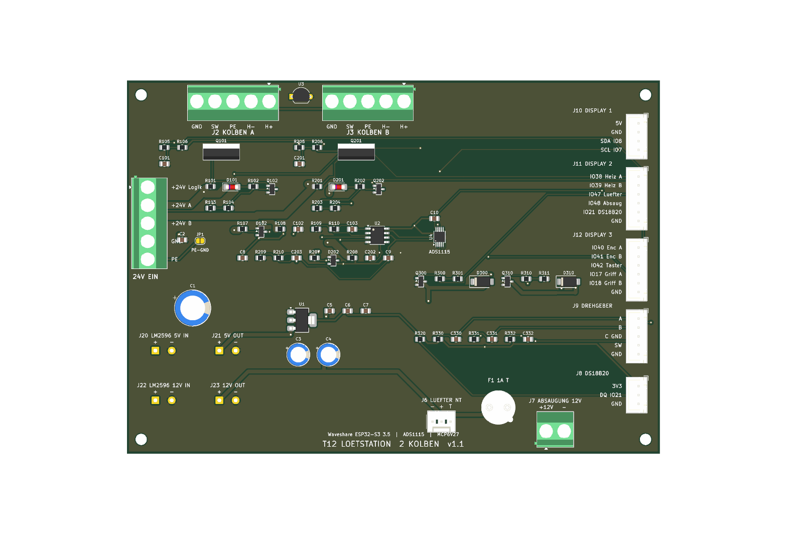
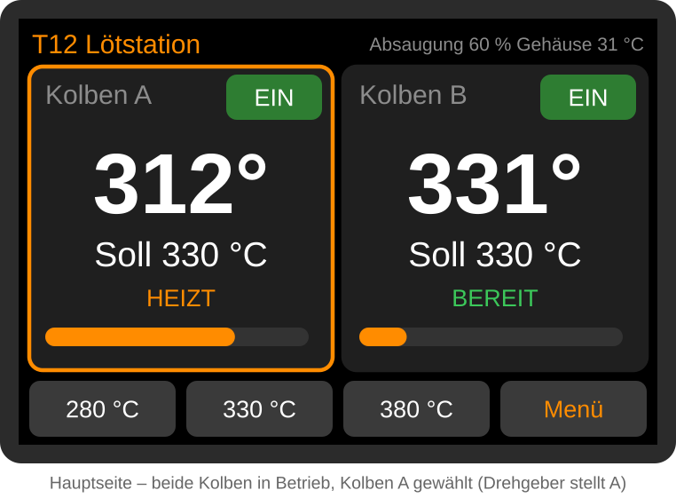
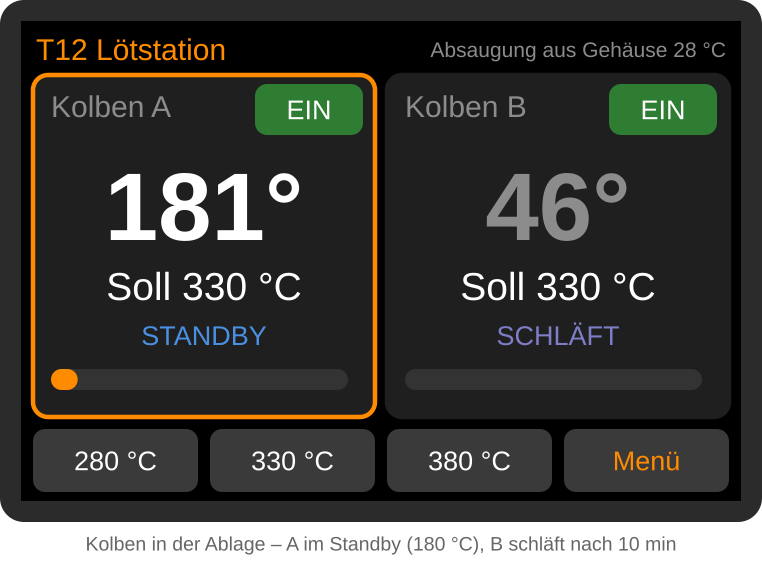
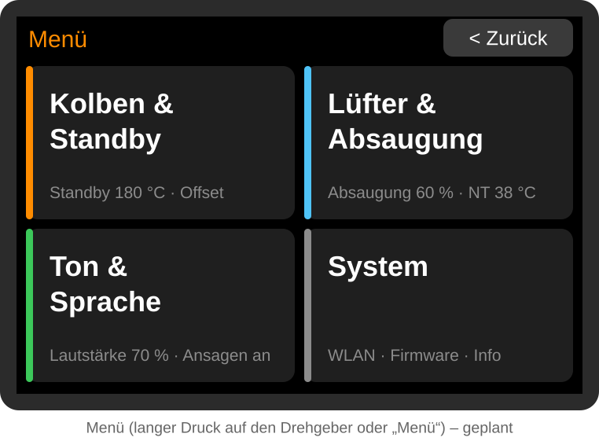
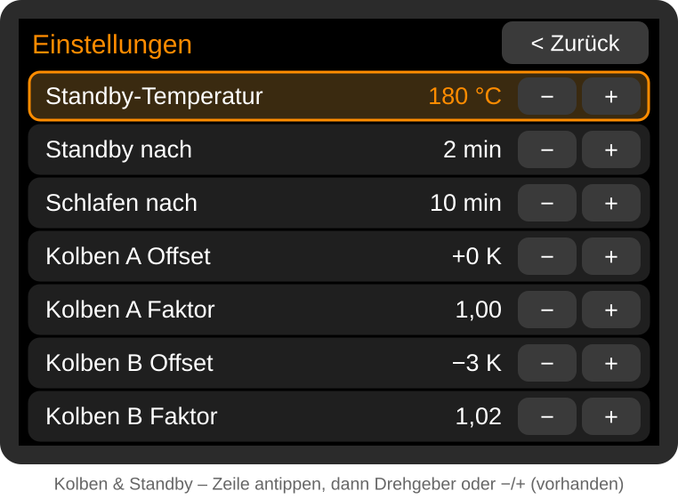
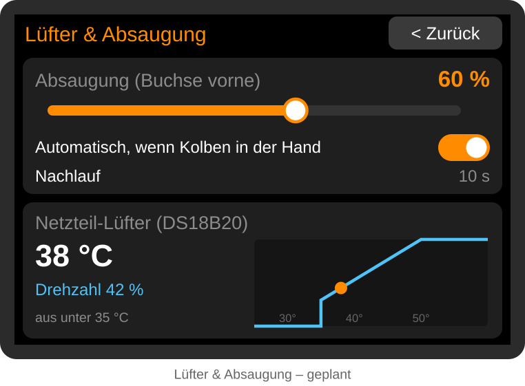
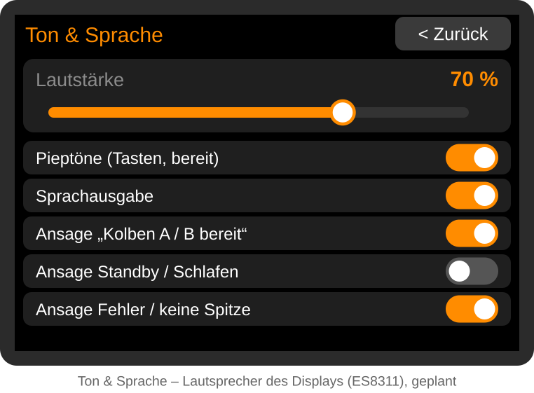
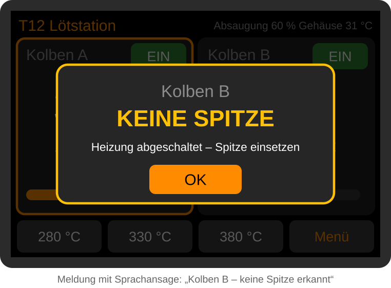

# T12 Lötstation – 2 Kolben gleichzeitig

Selbstgebaute Lötstation für **zwei T12-Lötspitzen gleichzeitig**, mit eigenem Touch-Display, Drehgeber, Lüftersteuerung, Anschluss für eine Lötrauch-Absaugung und Sprachausgabe.

> **Stand 13.11.2026: pausiert.** Die Platine (v1.1) ist fertig geprüft und bei JLCPCB bestellbar, aber noch nicht bestellt. Die Firmware ist ein Entwurf (noch nicht kompiliert, Lüfter/Absaugung/Ton fehlen).



## So soll es aussehen

Display: Waveshare ESP32-S3-Touch-LCD-3.5 quer (480 × 320), ESPHome + LVGL. Bedienung per Touch oder Drehgeber (drehen = Temperatur, langer Druck = Menü).

| | |
|---|---|
|  |  |
|  |  |
|  |  |
|  | |

Die Bilder werden mit [`docs/gen_menues.py`](docs/gen_menues.py) erzeugt (Maße und Farben wie in der Firmware). „Geplant“ heißt: in der Firmware noch nicht umgesetzt.

**Zustände pro Kolben:** AUS · HEIZT (orange) · BEREIT (grün) · KÜHLT AB · STANDBY (blau, Kolben in der Ablage) · SCHLÄFT · KEINE SPITZE (gelb) · Fehler Übertemperatur / heizt nicht / Messung (rot).

## Funktionen

- 2 × T12 an 24 V (je ca. 70 W), jede Spitze eigene Solltemperatur, Festwerte 280 / 330 / 380 °C
- Temperaturmessung im Heizpausen-Fenster: Auto-Zero-Verstärker MCP6V27 (× 221) → 16-Bit-ADC ADS1115, Kaltstelle MCP9700
- Standby und Schlafen über den Neigungsschalter im Griff, Erkennung „keine Spitze“
- Nach Stromausfall bleiben beide Kolben **aus**
- Netzteil-Lüfter 12 V, temperaturgeregelt über DS18B20
- Buchse vorne (Cinch) für eine 12-V-Absaugung: Drehzahl am Display, schaltet sich ein, wenn ein Kolben in die Hand genommen wird, 10 s Nachlauf
- Pieptöne und deutsche Sprachansagen über den Lautsprecher des Displays (ES8311)

## Hardware

| Teil | |
|---|---|
| Display | Waveshare ESP32-S3-Touch-LCD-3.5 |
| Netzteil | 24 V / 10 A |
| Spannungen | 2 × LM2596-Modul (5 V Display, 12 V Lüfter) per Kabel, AMS1117-3.3 für die Analogseite |
| Heizung | IRF5305 (P-Kanal, Plus-Seite) mit MMBT3904-Treiber, je Kolben eine Sicherung im Gehäuse |
| Bedienung | Drehgeber ALPS STEC12E08 |
| Lüfter | 2 × AO3400A mit 25 kHz PWM |

### GPIO-Belegung (Stiftleiste des Displays)

| GPIO | Funktion | | GPIO | Funktion |
|---|---|---|---|---|
| 38 | Heizung A | | 17 | Griffschalter A |
| 39 | Heizung B | | 18 | Griffschalter B |
| 40 / 41 | Drehgeber A / B | | 21 | DS18B20 |
| 42 | Drehgeber Taster | | 47 | Netzteil-Lüfter (PWM) |
| 8 / 7 | I²C SDA / SCL (ADS1115 0x48) | | 48 | Absaugung (PWM) |

## Platine

150 × 105 mm, 2 Lagen, vollständig bedruckt. Alle Klemmen und Buchsen sind mit Signal und GPIO beschriftet.

- **Schaltplan:** [pcb/t12-schaltplan.pdf](pcb/t12-schaltplan.pdf)
- **KiCad 10:** `pcb/t12-loetstation.kicad_pro`
- **Bestellung bei JLCPCB:** [pcb/jlc/ANLEITUNG.md](pcb/jlc/ANLEITUNG.md)
  - Gerber, Stückliste mit LCSC-Nummern (21 Positionen, nur SMD) und Bestückungsdatei liegen bereit.
  - Die Drehungen sind in der JLC-Vorschau kontrolliert.
- **Selbst löten:** die bedrahteten Teile ([pcb/jlc/Selbst_loeten.csv](pcb/jlc/Selbst_loeten.csv)): Schraubklemmen, JST-XH-Buchsen, IRF5305, Elkos, MCP9700, Sicherungshalter.

Die Platine wird komplett aus Python erzeugt (mit dem Python von KiCad aufrufen, im Ordner `pcb`):

```
design.py    Bauteile und Netze (eine Quelle für alles)
gen_sch.py   -> Schaltplan
gen_pcb.py   -> Platzierung, Bedruckung, Leiterbahnklassen
route.py     -> Freerouting (export / run / import), Masseflächen
make_jlc.py  -> Gerber-Zip, BOM, CPL für JLCPCB
```

### Änderungen v1.1 (Durchsicht vor der Bestellung)
- 1-MΩ-Pull-up (Erkennung „keine Spitze“) an die Spitze verlegt. Vorher hätte er den Messverstärker übersteuert.
- Filter am Messeingang 10 nF → 1 nF: schwingt nach dem Abschalten der Heizung in unter 1 ms ein.
- Massepads der Klemmen J1–J3 vollflächig an die Massefläche (2 × 3 A Heizstrom).
- Drehung der SS14-Dioden in der Bestückungsdatei korrigiert.

## Firmware

[`firmware/t12-loetstation.yaml`](firmware/t12-loetstation.yaml) + [`firmware/t12/loet.h`](firmware/t12/loet.h) (Regler, Zustände).

- **Regelung:** alle 100 ms. Beide Heizungen kurz aus, 3 ms warten, ADS1115 lesen, dann PI-Regler je Kolben.
- **Sicherheit:** über 480 °C, Spitze fehlt oder kein Temperaturanstieg in 20 s → Heizung aus.
- **WLAN-Daten:** per `!secret`, Vorlage in [`firmware/secrets.yaml.example`](firmware/secrets.yaml.example).

**Offen:**
- Lüfter, DS18B20, Absaugung
- Ton und Sprachausgabe
- Menüseiten 03, 05, 06
- Schalter auf `ALWAYS_OFF`
- Kalibrierung mit Spitzenthermometer
- Griffbelegung und Neigungsschalter nachmessen
