# T12-Lötstation mit 1 Kolben

Lötstation für **T12-Spitzen** mit großem Touch-Display, Drehgeber, deutscher Sprachausgabe, temperaturgeregeltem Netzteil-Lüfter, Anschluss für eine Absaugung und **Spitzenprofilen aus Home Assistant**.

Die eigentliche Regelung macht eine **fertige, günstige T12-Steuerplatine** (STM32), die eine **eigene Firmware** bekommt und per UART vom ESP32-Display gesteuert wird. Am Modul selbst wird nichts mehr bedient – alles läuft über Touch und Drehgeber.

> **Stand 22.11.2026:** Station im eigenen 3D-Druck-Gehäuse aufgebaut und mit **einem** Modul getestet (Heizen, Regeln, Standby, alle Menüs, Ansagen, Profile). Lüfter/IR-Sensor/DS18B20 sind programmiert; das Gehäuse der Absaugung folgt.

> Die Variante mit 2 Kolben steht im Ordner [`T12-Station-2-Kolben`](../T12-Station-2-Kolben).  Die Variante mit eigener Platine (KiCad, JLCPCB) liegt in [`T12-Loetstation`](../T12-Loetstation).

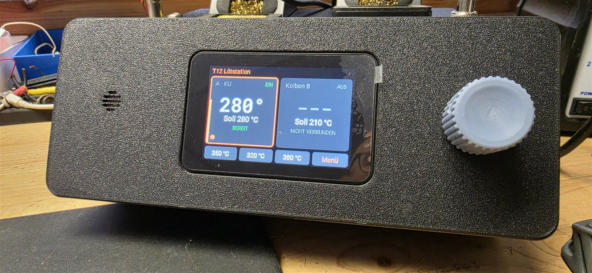

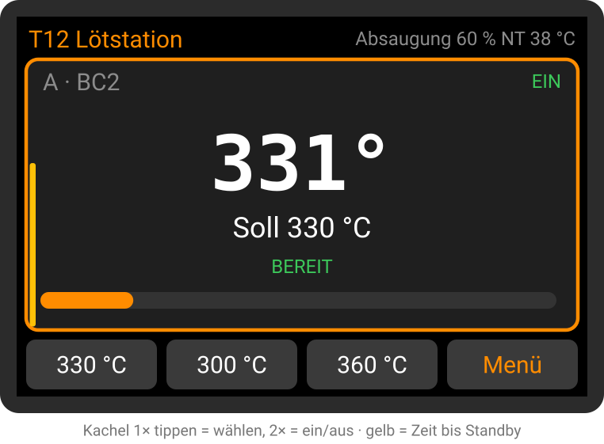

## Inhalt

1. [Funktionen](#funktionen)
2. [Teile und Hilfsmittel](#teile-und-hilfsmittel)
3. [Umbau am Modul (2 Drähte)](#umbau-am-modul-2-drähte)
4. [Modul flashen](#modul-flashen)
5. [Anschlussplan](#anschlussplan)
6. [ESPHome installieren](#esphome-installieren)
7. [Spitzenprofile (Home Assistant)](#spitzenprofile-home-assistant)
8. [Bedienung und Menüs](#bedienung-und-menüs)
9. [Protokoll Modul ↔ ESP](#protokoll-modul--esp)
10. [Fehlersuche](#fehlersuche)
11. [Gehäuse](#gehäuse)
12. [Dateien](#dateien)

## Funktionen

- Eine große Kachel, Ist-/Solltemperatur groß, Leistungsbalken, Status in Farbe (HEIZT, BEREIT, STANDBY, SCHLÄFT, KÜHLT AB, KEINE SPITZE, Fehler)
- **Kachel antippen:** 1× = auswählen, 2× = ein/aus (keine extra Tasten). Nach Stromausfall sind alle Kolben **aus**
- Schmale **Zeitlinie am Kachelrand**: gelb = Zeit bis Standby, blau = Zeit bis Schlafen – läuft von oben nach unten ab, Griffbewegung füllt sie wieder
- **Drehgeber:** drehen = ±5 °C, lang = Menü. 3 s nach dem letzten Dreh: Wert gespeichert + Ansage „Temperatur gespeichert“
- 3 **Festwert-Tasten** – mit Spitzenprofil die 3 Temperaturen der eingesetzten Spitze
- **Spitzenprofile** aus einer einfachen Datei in Home Assistant; nach einem Spitzenwechsel erscheint automatisch die Auswahl
- Einschalten **ohne Kolben/Spitze gesperrt** – Hinweis im Display und Ansage
- **Standby/Schlafen/Boost** im Modul, einstellbar im Menü; Kalt-Boost (kurz +50 °C beim Aufheizen) mit Anzeige „Soll 280 (330) °C“
- **Ansagen** (deutsche Stimme): bereit, kühlt ab, schläft, keine Spitze, Fehler, Verbindung unterbrochen, Temperatur gespeichert, Lötstation bereit
- **Netzteil-Lüfter** nach DS18B20 (Start-/Volllast-Temperatur einstellbar), **Absaugung** mit 5 Modi: Auto (läuft, solange ein Kolben bewegt wird + Nachlauf), Hand (IR-Sensor an der Absaugung + eigener Nachlauf), Auto + Hand, immer an, aus
- Menüs springen nach **20 s** ohne Bedienung zur Hauptseite zurück
- Sicherheit: das Modul regelt selbst; meldet sich der ESP 30 s nicht, geht es in Standby; Übertemperatur/Fehler schaltet das Modul ab
- Home Assistant: Hand-Sensor der Absaugung, Temperatur, Netzteil-Temperatur, Lüfter, Absaugung, Mediaplayer „Ansage“

## Teile und Hilfsmittel

| Teil | Hinweis | Link |
|---|---|---|
| 1 × T12-Steuerplatine **STM32 Ver21S** (KSGER-v2-Bauform, ca. 28 €) | STM32F103C8, **4-poliger OLED-Anschluss** (VCC GND SCL SDA). Chip muss echter STM32 oder CKS32 sein (GD32/CH32 machen ADC-Probleme) | [Amazon](https://www.amazon.de/dp/B0F4X2F72V) |
| Waveshare **ESP32-S3-Touch-LCD-3.5** | 480×320, Touch, Lautsprecher-Verstärker, PSRAM. **Nicht** die Version „3.5B“ | [Amazon](https://www.amazon.de/dp/B0F6TM959R) · [Doku](https://docs.waveshare.com/ESP32-S3-Touch-LCD-3.5) |
| Netzteil 24 V | ≥ 4 A | – |
| T12-Griff(e) + Spitzen | z. B. FX9501-Griff mit Neigungsschalter | – |
| Drehgeber-Modul KY-040 | CLK, DT, SW, +, − | – |
| 2 × LM2596 Step-down | 24→5 V (Display, Pin 2), 24→12 V (Lüfter) – **vor dem Anschließen einstellen** | – |
| IR-Hindernis-Modul (HIGH bei Erkennung, 3,3 V) + 1 kΩ + 10 kΩ | Hand-Sensor an der Absaugung (GPIO 44) | – |
| GX12-5 Buchse + Stecker, 5-adriges Kabel | Absaugung: Pin 1 = +12 V, 2 = Lüfter − (geschaltet), 3 = 3,3 V, 4 = OUT, 5 = GND | – |
| DS18B20 + 4,7 kΩ | Netzteil-Temperatur | – |
| 2 × IRLML6344 (oder AO3400) + 2 × SB 120 (oder SS14) + 100 Ω + 100 kΩ | Lüfter-Schalter (low-side, 25 kHz PWM), siehe [Schaltplan](docs/luefter_schaltplan.svg) | – |
| Lautsprecher | an den MX1.25-Lautsprecherstecker des Displays | – |
| Kabel | Dupont-Litzen 22 AWG, dünner Kupferlackdraht 0,1–0,2 mm für den Umbau | – |

**Werkzeug / Software**

| Was | Wofür | Download |
|---|---|---|
| ST-Link V2 (Nachbau genügt) | Modul flashen (SWD) | – |
| xPack OpenOCD 0.12.0 | Flash-Programm (ohne Installation) | [GitHub Releases](https://github.com/xpack-dev-tools/openocd-xpack/releases) |
| ESPHome (Device Builder in Home Assistant) | Display-Firmware | [esphome.io](https://esphome.io) |
| feine Lötspitze, Flussmittel, Lupe | Umbau mit 0,5-mm-Pinabstand | – |
| *optional* STM32CubeIDE 1.12.1 | Modul-Firmware selbst bauen | [Spiegel beim Autor](https://github.com/deividAlfa/stm32_soldering_iron_controller/releases/tag/CubeIDE_v1.12.1) |

## Umbau am Modul (2 Drähte)

Die OLED-Pads des Moduls hängen an Software-Pins (PB12/PB13). Die serielle Schnittstelle USART3 des STM32 liegt aber auf **PB10/PB11** – die sind auf der Platine nicht verbunden. Zwei dünne Drähte legen sie auf die OLED-Pads:

| von Chip-Pin | an OLED-Pad | Bedeutung |
|---|---|---|
| **Pin 21 = PB10** | **SCL** | Modul **sendet** (TX) |
| **Pin 22 = PB11** | **SDA** | Modul **empfängt** (RX) |

Die Pins liegen auf der Chip-Seite unter **R2** (zum AMS1117), **3. und 4. Pin von oben**. Pin 1 ist der Punkt unten links.

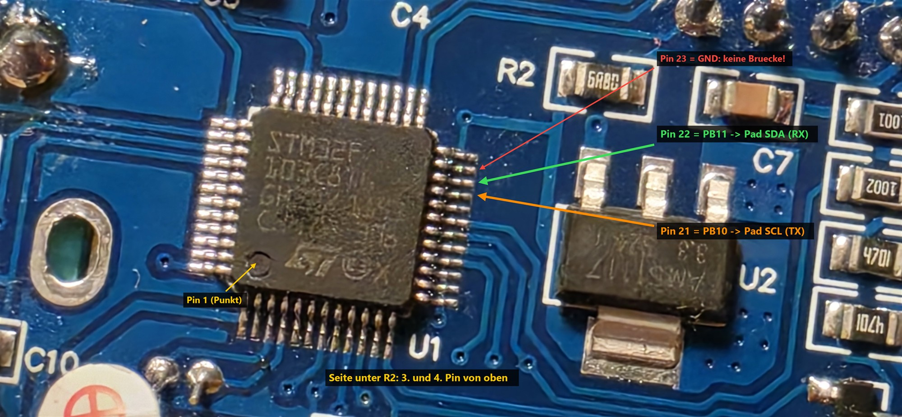

- Kupferlackdraht 0,1–0,2 mm, Enden mit heißem Kolben abisolieren und verzinnen
- viel Flussmittel, Draht nur kurz an den Pin halten, **keine Brücke** – besonders nicht zu **Pin 23 (GND)** daneben
- Drähte mit einem Tropfen Heißkleber fixieren, mit Lupe kontrollieren
- Empfehlung: in die 4 OLED-Pads eine **Buchsenleiste** löten – dann steckt dort wahlweise das OLED oder das Kabel zum ESP

Die Leiterbahnen zu PB12/PB13 müssen **nicht** getrennt werden: die UART-Firmware schaltet diese Pins hochohmig.

| Rückseite | Vorderseite |
|---|---|
| 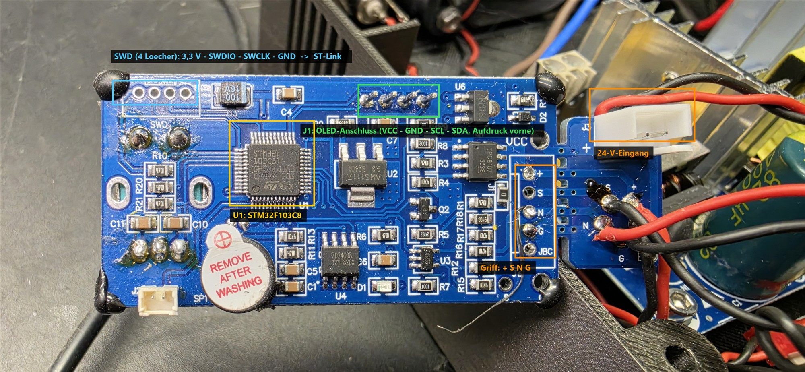 | 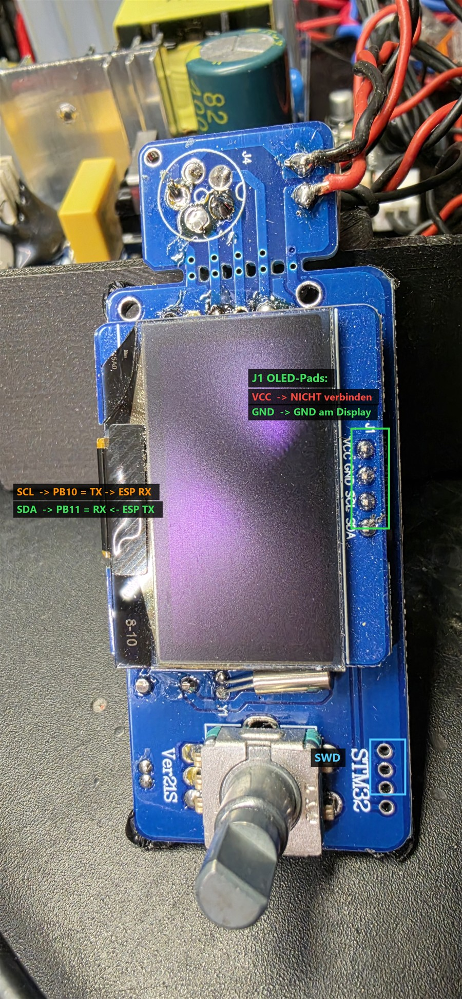 |

**Drähte prüfen** (ST-Link angeschlossen): [`werkzeuge/2_drahttest.cmd`](werkzeuge/2_drahttest.cmd) schaltet die Pads über den Chip und liest PB10/PB11 zurück. Erwartet wird `SDA=1 SCL=0 → PB10=0 PB11=1` und umgekehrt.

## Modul flashen

**Anschluss ST-Link V2 (Nachbau, 10-polig)** an die 4 SWD-Löcher des Moduls (Aufdruck „SWD“/„STM32“). **24 V aus**, OLED ab bzw. abgezogen:

| ST-Link | Modul |
|---|---|
| Pin 2 SWCLK | SWCLK |
| Pin 4 SWDIO | SWDIO |
| Pin 6 GND | GND |
| Pin 8 **3,3 V** | 3,3 V (VCC) – **nicht 5 V!** |

GND und 3,3 V findest du mit dem Durchgangsprüfer (GND = Masse, 3,3 V = Kühlfahne des AMS1117). Bleibt die Verbindung aus: SWDIO und SWCLK tauschen.

1. [xPack OpenOCD](https://github.com/xpack-dev-tools/openocd-xpack/releases) entpacken, in den `.cmd`-Dateien unter [`werkzeuge/`](werkzeuge) den Pfad `OCD=` anpassen
2. **Original sichern:** [`1_original_sichern.cmd`](werkzeuge/1_original_sichern.cmd) – liest zweimal und vergleicht (geht nur, wenn der Ausleseschutz aus ist; bei unseren Modulen war er aus)
3. *(nach dem Umbau)* **Drähte prüfen:** [`2_drahttest.cmd`](werkzeuge/2_drahttest.cmd)
4. **Firmware schreiben:** [`3_modul_flashen.cmd`](werkzeuge/3_modul_flashen.cmd) → muss „**Verified OK**“ melden. Der Chip wird **nicht** komplett gelöscht, Kalibrierung/Einstellungen bleiben
5. Zurück zum Original: [`4_original_zurueck.cmd`](werkzeuge/4_original_zurueck.cmd)

**Wichtig:** Viele ST-Link-Nachbauten haben eine alte Firmware (V2J21…). Dann geht nur der „HLA“-Modus – genau den nutzen die Skripte (`interface/stlink-hla.cfg`, `transport select hla_swd`). Der Chip meldet nur 64 KB, die Firmware braucht aber den zweiten 64-KB-Block – daher `set FLASH_SIZE 0x20000`.

**Erst-Einrichtung (empfohlen):** Vor dem Umbau einmal die offene Firmware von deividAlfa ([KSGER_v2_OLED](https://github.com/deividAlfa/stm32_soldering_iron_controller/releases)) mit OLED aufspielen und im Menü die Spitze **kalibrieren**. Diese Einstellungen übernimmt die UART-Firmware. Die Datei [`modul-firmware/t12_uart_v4.bin`](modul-firmware/t12_uart_v4.bin) ist diese Firmware mit unserer UART-Erweiterung; wie man sie selbst baut, steht in [`modul-firmware/BAUEN.md`](modul-firmware/BAUEN.md).

## Anschlussplan

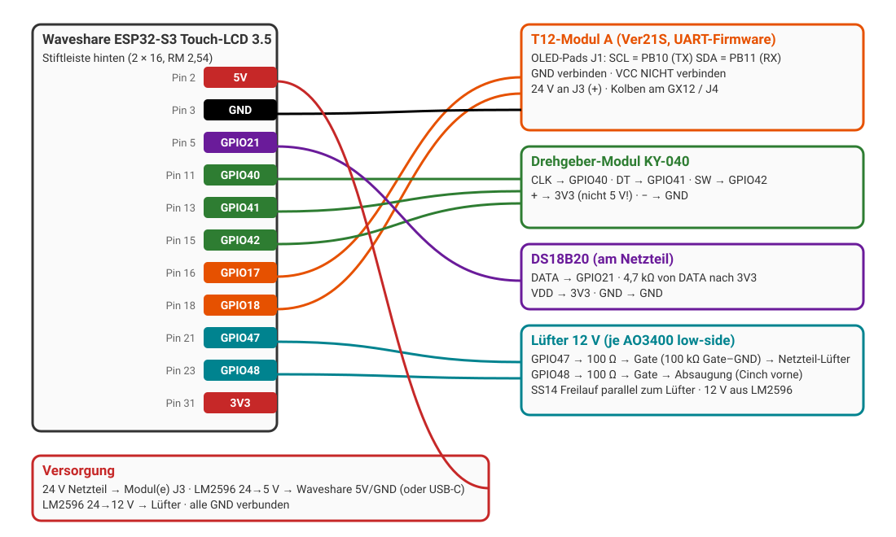

| Waveshare-Leiste | an |
|---|---|
| GPIO 17 (Pin 16) | Modul A Pad **SDA** |
| GPIO 18 (Pin 18) | Modul A Pad **SCL** |
| GND (Pin 3/29) | GND der Module, Drehgeber, DS18B20, Lüfter |
| GPIO 40 / 41 / 42 (Pin 11/13/15) | Drehgeber CLK / DT / SW |
| 3V3 (Pin 31/32) | Drehgeber +, DS18B20 VDD + 4,7 kΩ |
| GPIO 21 (Pin 5) | DS18B20 DATA |
| GPIO 47 (Pin 21) | Netzteil-Lüfter (über AO3400) |
| GPIO 48 (Pin 23) | Absaugung (über AO3400) |
| 5V (Pin 2) | LM2596 (Display) 5 V (oder USB-C) |
| GPIO 44 (Pin 27) | IR-Sensor OUT über 1 kΩ (GX12-5 Pin 4), 10 kΩ nach GND |
| 3V3 (Pin 32) / GND (Pin 30) | IR-Sensor VCC / GND (GX12-5 Pin 3 / 5) |

- **VCC der Module NICHT verbinden** – jedes Modul bekommt seine 3,3 V selbst aus den 24 V. Nur GND gemeinsam.
- Beide Seiten arbeiten mit 3,3 V, kein Pegelwandler nötig. Sind TX/RX vertauscht, einfach die zwei Leitungen am ESP tauschen.
- Drehgeber-Modul: **+ an 3,3 V**, nicht 5 V. Dreht er falsch herum: CLK und DT tauschen.

### Versorgung, Lüfter, Absaugung, IR-Sensor und DS18B20

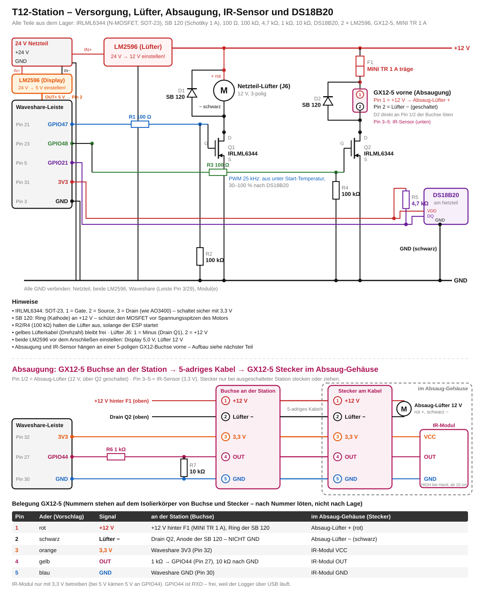

- Je Lüfter ein **N-MOSFET auf der Minus-Seite** (logic level, schaltet mit 3,3 V): **IRLML6344** oder AO3400 (SOT-23, 1 = Gate, 2 = Source, 3 = Drain). **Nicht** IRF520/IRF540 – die brauchen 10 V am Gate.
- **100 Ω** GPIO → Gate, **100 kΩ** Gate → GND (Lüfter bleiben aus, solange der ESP startet).
- **Freilaufdiode SB 120** (oder SS14/1N5819) parallel zum Lüfter, **Ring an +12 V**. Bei der Absaugung direkt an Pin 1/2 der GX12-5-Buchse.
- Absaugung: **MINI TR 1 A träge** in der +12-V-Leitung zu Pin 1 der GX12-5, Pin 2 = geschalteter Minus (Drain Q2, **nicht GND**).
- **Eine Buchse für die Absaugung: GX12-5** vorne, 5-adriges Kabel zum Absaug-Gehäuse. Pin 1 = +12 V, Pin 2 = Lüfter −, Pin 3 = 3,3 V, Pin 4 = OUT, Pin 5 = GND. Im Absaug-Gehäuse: Pin 1/2 an den Lüfter, Pin 3–5 an das IR-Modul. Nur bei ausgeschalteter Station stecken.
- **IR-Sensor:** OUT über **1 kΩ** an GPIO 44, **10 kΩ** von GPIO 44 nach GND (ohne Sensor = aus). Das Modul nur mit 3,3 V betreiben.
- **Display-Versorgung:** zweiter **LM2596 24 V → 5 V** an Pin 2 (5V) und GND. Erst ohne Display auf 5,0 V einstellen.
- DS18B20 an GPIO 21 mit **4,7 kΩ** von DATA nach 3,3 V.
- Fertige MOSFET-Module gehen auch (**D4184 / AOD4184**, ohne Optokoppler wegen 25 kHz PWM).
- Erzeugt mit [`docs/gen_luefter_schaltplan.py`](docs/gen_luefter_schaltplan.py).

### Komplette Verdrahtung – Werkstattblatt

Alles auf einem Blatt zum Ausdrucken: Lüfter-Schaltplan, die Stiftleiste des Displays (alle 32 Pins, was wo dran kommt) und eine Tabelle mit allen Verbindungen.

- [**verdrahtung_komplett.pdf**](docs/verdrahtung_komplett.pdf) (zum Drucken: 4 Blätter A4 quer – Schaltplan, Absaugung mit GX12-5-Belegung, Stiftleiste, Verbindungstabelle)
- [verdrahtung_komplett.svg](docs/verdrahtung_komplett.svg)
- Erzeugt mit [`docs/gen_verdrahtung.py`](docs/gen_verdrahtung.py) (`python gen_verdrahtung.py 2` bzw. `1`, braucht vorher `luefter_schaltplan.svg`; erzeugt auch die Druckvorlage `verdrahtung_druck.html`, daraus wird das PDF gedruckt).

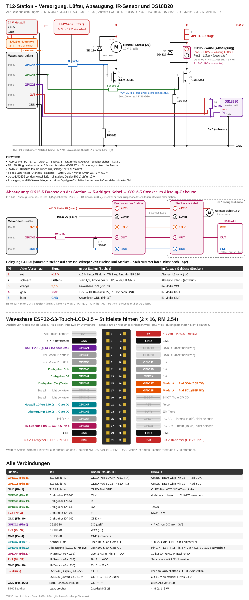

## ESPHome installieren

1. Den Inhalt von [`esphome/`](esphome) nach `/config/esphome/` kopieren: `t12-loetstation.yaml` und den Ordner `t12/` (Hilfsdatei `t12.h` + Sprachdateien `sound/*.wav`)
2. In `t12-loetstation.yaml` oben anpassen: `ha_url` (Adresse deines Home Assistant); `anzahl_kolben` steht schon auf `"1"`
3. `secrets.yaml` braucht `wifi_ssid` und `wifi_password`
4. Profildatei nach `/config/www/t12_profile.yaml` kopieren (siehe unten)
5. Im Device Builder **Install** – beim ersten Mal per USB, danach drahtlos

Getestet mit **ESPHome 2026.11** (ESP-IDF, LVGL 9). Die Sprachdateien wurden mit der Windows-Stimme „Hedda“ erzeugt (16 kHz, mono) – eigene WAVs mit gleichem Namen gehen auch.

## Spitzenprofile (Home Assistant)

Eine einfache Textdatei in Home Assistant: **`/config/www/t12_profile.yaml`** (im Datei-Editor unter `www`). Die Station holt sie über `http://<home-assistant>:8123/local/t12_profile.yaml` – beim Start, alle 10 Minuten und mit **Menü → Festwerte → Neu laden**.

```yaml
# - Name, T1, T2, T3, Standby °C, Standby min, Schlafen min
- BC2, 330, 300, 360, 180, 5, 20
- K, 350, 320, 380, 200, 5, 20
- D24, 340, 310, 370            # ohne Standby-Werte: Werte aus dem Menü bleiben
```

| Feld | Bedeutung |
|---|---|
| Name | max. 16 Zeichen, erscheint in der Kachel („A · BC2“) |
| Temperatur 1 | wird beim Auswählen als **Solltemperatur** gesetzt |
| Temperatur 1–3 | liegen dann auf den **drei Festwert-Tasten** |
| Standby °C | Temperatur im Standby, 100–300 °C *(freiwillig)* |
| Standby min | Minuten ohne Bewegung bis Standby, 0 = nie, max. 60 *(freiwillig)* |
| Schlafen min | Minuten bis Schlafen (Heizung aus), 1–120 *(freiwillig)* |

Die drei Standby-Werte gehen beim Auswählen der Spitze ans Modul (nur in den Arbeitsspeicher, der Flash wird nicht beschrieben) und erscheinen auch in **Menü → Kolben & Standby** mit dem Hinweis „Standby-Werte aus dem Spitzenprofil“. Wer dort von Hand verstellt, hat Vorrang bis zur nächsten Spitzenwahl. Fehlen die Werte in der Zeile, bleiben die Menüwerte. Nach einem Neustart des Moduls schickt die Station die Profilwerte automatisch erneut.

Regeln: eine Zeile pro Spitze, max. 20 Spitzen, Temperaturen 150–450 °C, Zeilen mit `#` werden ignoriert. Fehlt Temperatur 2/3, wird Temperatur 1 genommen.

**Downloads:** [`t12_profile.yaml`](esphome/www/t12_profile.yaml) (Beispiele + Testwerte) · [`t12_profile_test.yaml`](esphome/www/t12_profile_test.yaml) (nur Testwerte TEST 1–3: 250/260/270, 300/310/320, 355/365/375 – gut am Display erkennbar; TEST 1 mit Standby nach 1 min und Schlafen nach 3 min, TEST 2 ohne Standby-Werte, TEST 3 nie Standby)

**So testest du:** Testdatei als `t12_profile.yaml` nach `/config/www/` kopieren → Menü → Festwerte → „Neu laden“ → „3 Spitzen aus Home Assistant“. Dann Spitze ziehen und wieder einstecken → Auswahl erscheint → „TEST 1“ wählen → Soll 250 °C, Tasten 250/260/270, Kachel „A · TEST 1“. Im Menü Kolben & Standby stehen jetzt 160 °C / 1 min / 3 min; nach 1 min Kolben liegen lassen geht er in Standby (gelbe Linie läuft ab).

Profile ausschalten: Menü → Festwerte → „Spitzenprofile aus HA“. Dann gelten die drei eigenen Festwerte.

**Ohne WLAN:** Die Station merkt sich die zuletzt geladenen Profile im Flash des ESP (geschrieben wird nur, wenn sich die Datei geändert hat). Nach dem Einschalten ohne WLAN oder ohne Home Assistant sind die Profile also trotzdem da; Löten, Regeln, Standby, Lüfter und Ansagen laufen ganz normal. Die Station startet ohne WLAN auch nicht neu (`reboot_timeout: 0s`). Es fehlen dann nur das Nachladen geänderter Profile und die Werte in Home Assistant.

## Bedienung und Menüs

### Hauptseite
Kachel antippen: 1× wählen (oranger Rahmen), 2× ein/aus. Oben rechts in der Kachel EIN/AUS, unten Leistung. Die Linie am Rand zeigt die Zeit bis Standby (gelb).


### Standby
Im Standby steht das Ziel in Klammern, die Linie wird blau (Zeit bis Schlafen). Griff bewegen weckt den Kolben.

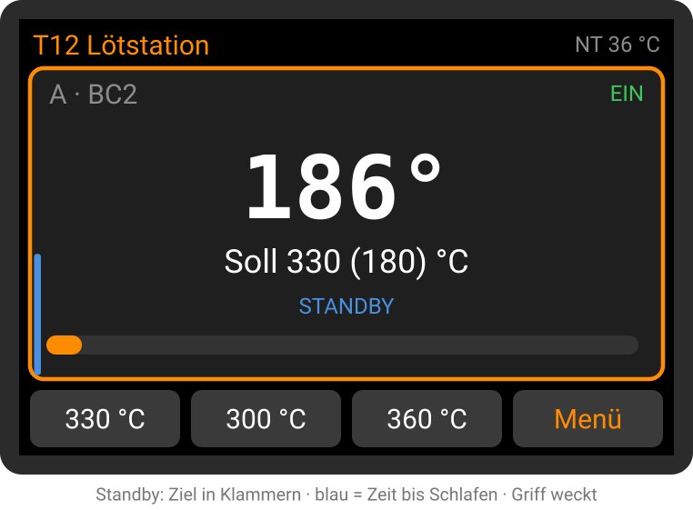

### Menü
Über die Taste „Menü“ oder Drehgeber lang drücken. Alle Menüs springen nach 20 s zurück.

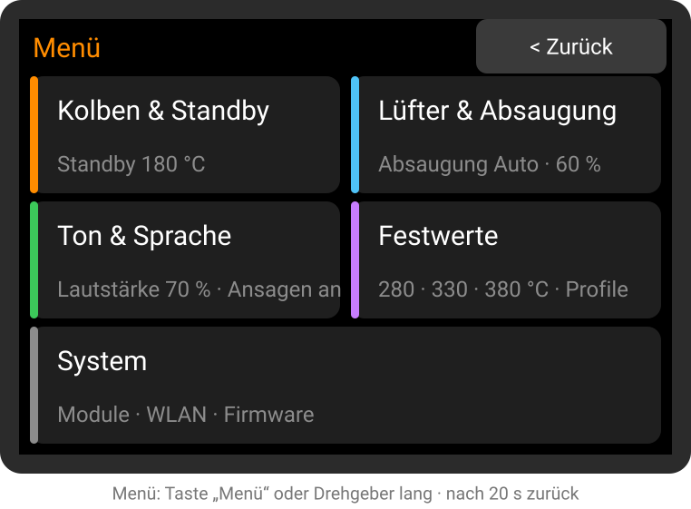

### Kolben & Standby
Standby-Temperatur, Standby nach, Schlafen nach, Boost und Boost-Dauer – die Werte stehen im Modul und werden beim Verlassen gespeichert.

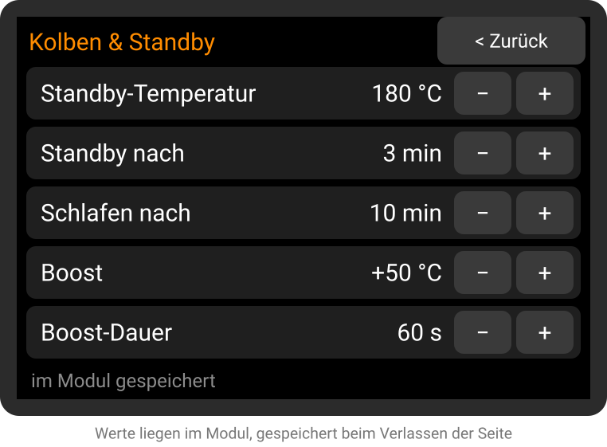

### Lüfter & Absaugung
Absaugung **Auto** (Kolben in der Hand) → **Hand (IR)** → **Auto + Hand** → **Immer an** → **Aus** (Taste schaltet weiter), Drehzahl, **Nachlauf Kolben** (0–120 s) und **Nachlauf Hand (IR)** (5 s – 10 min, zählt ab dem Wegnehmen der Hand); Netzteil-Lüfter ab Temperatur X, volle Drehzahl ab Y.

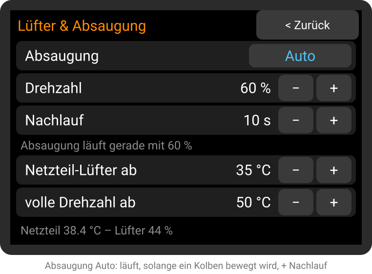

### Ton & Sprache
Lautstärke, Pieptöne, Sprachausgabe und die einzelnen Ansagen; „Test“ spielt eine Ansage.

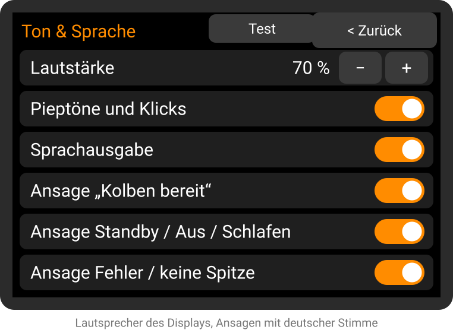

### Festwerte
Drei eigene Festwerte (ohne Profil), Spitzenprofile an/aus, neu laden und Spitze von Hand wählen.

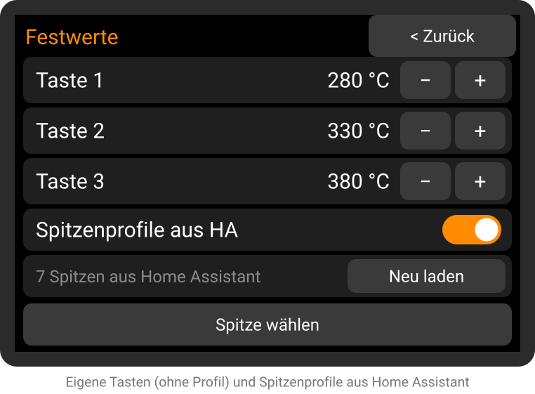

### System
Verbindung, Spannung, Griff-Temperatur und Fehler der Module, Firmware-Stand, WLAN-Adresse.

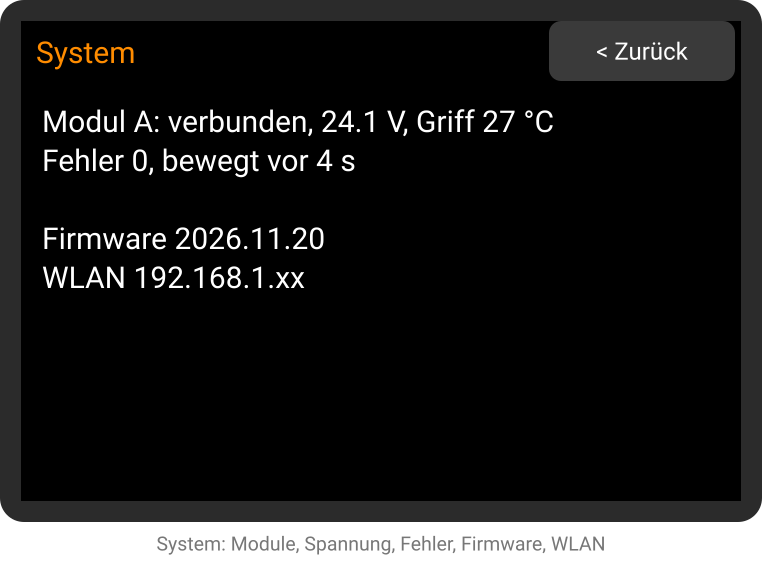

### Profilauswahl
Erscheint nach einem Spitzenwechsel: Drehgeber dreht die Liste, Drücken übernimmt. Auch per Touch.

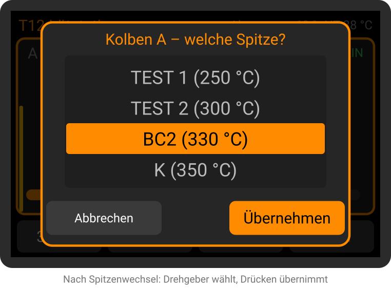

### Einschaltsperre
Ohne Kolben oder Spitze lässt sich nicht einschalten – Hinweis und Ansage.

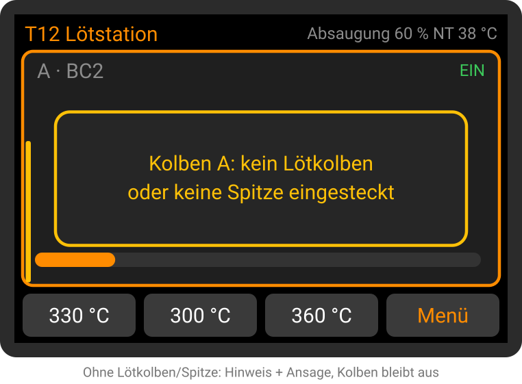

Die Bilder werden mit [`docs/gen_bilder.py`](docs/gen_bilder.py) erzeugt (Maße und Farben wie in der Firmware).

## Protokoll Modul ↔ ESP

UART 115200 8N1, Textzeilen. Ausführlich im Kopf von [`modul-firmware/quellcode/uart_remote.c`](modul-firmware/quellcode/uart_remote.c).

| ESP → Modul | Bedeutung |
|---|---|
| `S 330` | Solltemperatur |
| `E 1` / `E 0` | ein / aus (aus = Schlaf, Griff weckt nicht) |
| `M n` | Betriebsart 0 Schlaf · 1 Standby · 2 Betrieb · 3 Boost |
| `G` | Einstellungen lesen → `$CFG,…` |
| `C n w` | Einstellung n setzen (0 Standby-°C, 1 Standby s, 2 Schlafen s, 3 Boost +°C, 4 Boost s) |
| `W` | Einstellungen im Flash speichern → `$SAVED` |
| `P` / `?` | Lebenszeichen / Status sofort |

Modul → ESP alle 200 ms: `$T12,ist,soll,ziel,leistung,modus,fehler,vin_x10,ntc_x10,griff_s,ein,link,modus_s`

Der ESP schickt alle 2 s Solltemperatur und EIN/AUS als Lebenszeichen. Das Modul übernimmt sie **nur bei Änderung** (sonst würden Boost-, Standby- und Schlafzeit ständig neu starten).

## Fehlersuche

| Problem | Lösung |
|---|---|
| OpenOCD „unable to connect“ | SWDIO/SWCLK tauschen; 3,3 V angeschlossen? |
| „only supports deprecated HLA“ | ST-Link-Firmware alt → Skripte nutzen schon HLA |
| Display: „keine Verbindung zum Modul“ | GND verbunden? TX/RX am ESP tauschen; UART-Firmware drauf? |
| Temperatur kurz ~50 °C zu hoch | Kalt-Boost (10 s), Anzeige „Soll 280 (330)“ – normal |
| „lese Einstellungen …“ bleibt | Modul-Firmware älter als v2 → `t12_uart_v4.bin` flashen |
| Zeitlinie fehlt | Modul-Firmware älter als v4 |
| „keine Profile geladen“ | `ha_url` prüfen; Datei unter `/config/www/`? Im Browser `http://<HA>:8123/local/t12_profile.yaml` öffnen |

## Gehäuse

Eigenes 3D-Druck-Gehäuse (Fusion 360), 250 mm breit: schräge Front mit Display, Lautsprecher-Gitter und Drehknopf, oben zwei Kolbenablagen, hinten Lüftergitter für den Netzteil-Lüfter. Es ist für 2 Kolben gezeichnet und passt für einen Kolben unverändert (zweite Ablage/Buchse bleibt frei).

| Station | Fusion 360 |
|---|---|
| 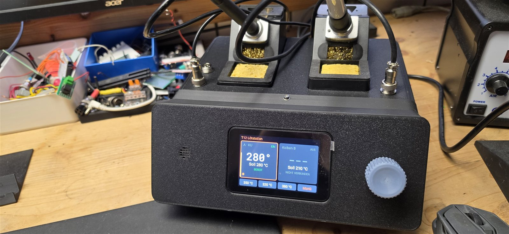 | 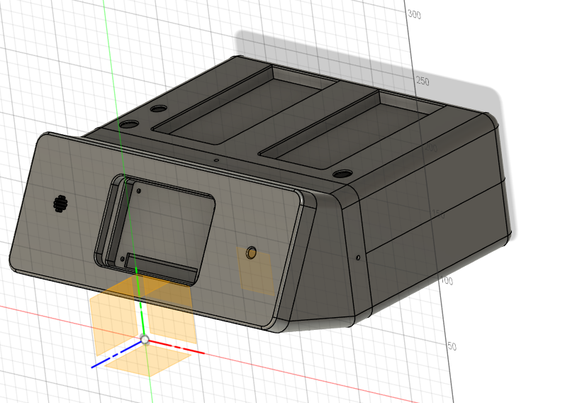 |

- **Druckdateien:** [`Frame_unten.stl`](../T12-Station-2-Kolben/gehaeuse/stl/Frame_unten.stl), [`Frame_oben.stl`](../T12-Station-2-Kolben/gehaeuse/stl/Frame_oben.stl), [`Front.stl`](../T12-Station-2-Kolben/gehaeuse/stl/Front.stl), [`Drehknopf.stl`](../T12-Station-2-Kolben/gehaeuse/stl/Drehknopf.stl)
- **Zum Ändern:** [`Loetstation_ESP32_Touch_3_5zoll.f3d`](../T12-Station-2-Kolben/gehaeuse/fusion/Loetstation_ESP32_Touch_3_5zoll.f3d) (Fusion 360)
- Druckbett mindestens 256 mm (z. B. Bambu Lab X1C / P1S), Material PETG oder ASA empfohlen. Details: [Gehäuse-README](../T12-Station-2-Kolben/gehaeuse/README.md)
- Das Gehäuse der Absaugung (Lüfter + IR-Sensor an GX12-5) folgt.

## Dateien

```
T12-Station-1-Kolben/
├─ esphome/
│  ├─ t12-loetstation.yaml      ESPHome-Konfiguration (anzahl_kolben: "1")
│  ├─ t12/t12.h                Hilfsfunktionen (Protokoll, Zustände, Profile)
│  ├─ t12/sound/*.wav          Ansagen und Töne
│  └─ www/t12_profile*.yaml    Profildatei + Testdatei
├─ modul-firmware/
│  ├─ t12_uart_v4.bin          fertige Modul-Firmware
│  ├─ quellcode/               uart_remote.c/.h + Patch für user_main.c/settings.c
│  └─ BAUEN.md                 selbst übersetzen
├─ werkzeuge/                  OpenOCD-Skripte: sichern, Drahttest, flashen, zurück
├─ docs/                       Bilder, Anschlussplan, Bild-Generator
└─ gehaeuse/                  Verweis auf das Gehäuse der 2-Kolben-Variante
```

Grundlage der Modul-Firmware: [deividAlfa/stm32_soldering_iron_controller](https://github.com/deividAlfa/stm32_soldering_iron_controller) (GPL). Unsere Erweiterung (UART-Fernsteuerung) liegt als eigene Dateien + Patch bei.
