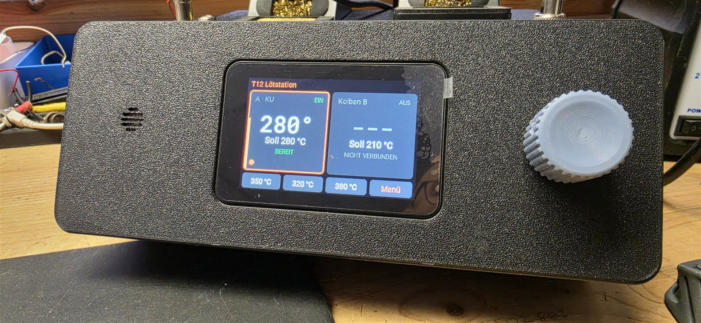

# Gehäuse – T12-Station (1 Kolben)

Das Gehäuse gibt es bisher nur in der Ausführung für **2 Kolben**: [`T12-Station-2-Kolben/gehaeuse`](../../T12-Station-2-Kolben/gehaeuse) (STL-Dateien, Fusion-360-Datei, Fotos) – auch auf [MakerWorld](https://makerworld.com/de/models/3663781-t12-lotstation-esp32-s3-touch-display-2-kolben).

Für einen Kolben passt es unverändert – zweite Ablage und zweite Kolbenbuchse bleiben dann frei. Wer es schmaler möchte, passt die Fusion-Datei an.

