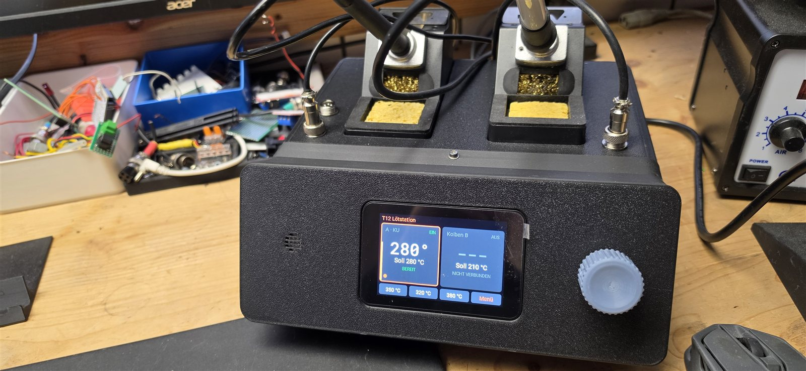
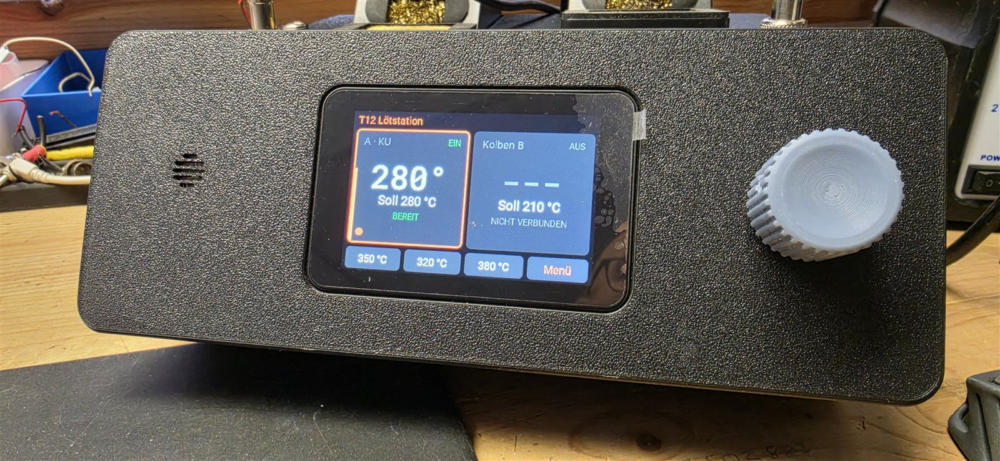
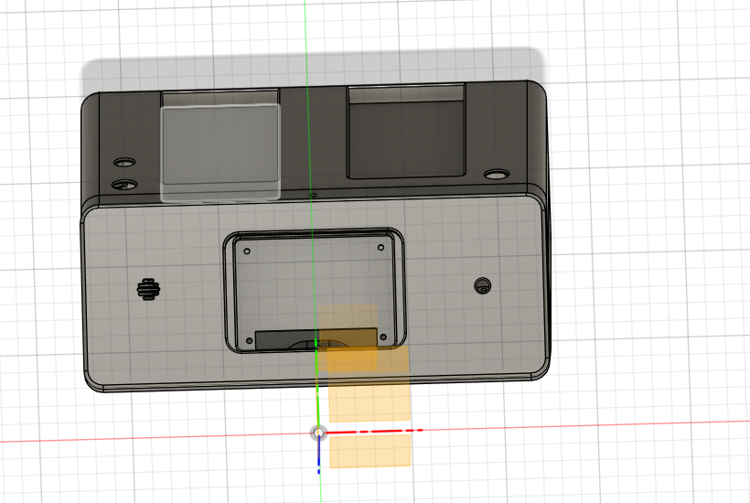
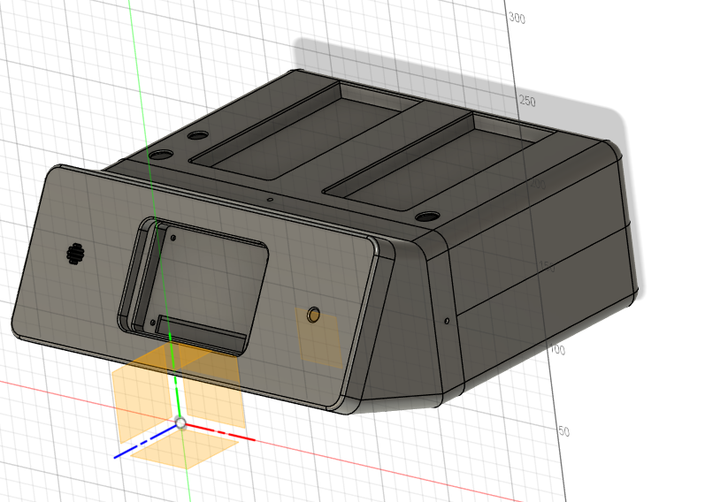
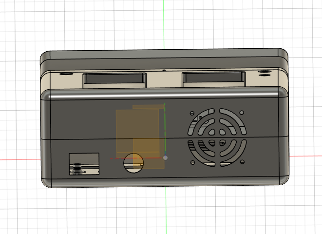

# Gehäuse – T12-Station (2 Kolben)

3D-Druck-Gehäuse für die Station: Waveshare ESP32-S3-Touch-LCD-3.5 vorne in der schrägen Front, Drehgeber rechts daneben, oben zwei Ausschnitte für die Kolbenablagen, hinten Lüftergitter für den Netzteil-Lüfter.

| Fusion 360 – vorne | Fusion 360 – seitlich | Fusion 360 – hinten |
|---|---|---|
|  |  |  |

**Auf MakerWorld:** [T12-Lötstation ESP32-S3 Touch-Display, 2 Kolben](https://makerworld.com/de/models/3663781-t12-lotstation-esp32-s3-touch-display-2-kolben)

## Dateien

| Datei | Teil | Größe (B × H × T) |
|---|---|---|
| [`stl/Frame_unten.stl`](stl/Frame_unten.stl) | Unterteil des Rahmens | 250 × 60 × 169 mm |
| [`stl/Frame_oben.stl`](stl/Frame_oben.stl) | Oberteil mit den Ausschnitten für die Kolbenablagen | 250 × 50 × 169 mm |
| [`stl/Front.stl`](stl/Front.stl) | schräge Front mit Display-Ausschnitt, Lautsprecher-Gitter und Loch für den Drehgeber | 250 × 116 × 101 mm |
| [`stl/Drehknopf.stl`](stl/Drehknopf.stl) | Drehknopf für den Drehgeber | Ø 30 × 22 mm |
| [`fusion/Loetstation_ESP32_Touch_3_5zoll.f3d`](fusion/Loetstation_ESP32_Touch_3_5zoll.f3d) | Fusion-360-Datei zum Ändern | – |

Die Maße sind aus den STL-Dateien ausgelesen (Achsen wie exportiert, nicht als Druckausrichtung gedacht).

## Drucken

- **Druckbett:** Rahmen und Front sind **250 mm** breit – das passt auf Drucker mit 256 mm Bett (z. B. Bambu Lab X1C / P1S). Für kleinere Drucker die Teile in der Fusion-Datei teilen.
- **Material:** Wegen der Wärme von Netzteil und Kolbenablagen besser **PETG oder ASA** als PLA (Empfehlung).
- Die Teile im Slicer flach auf die größte Fläche drehen.

## Einbau (Kurzfassung)

1. Display von hinten in den Ausschnitt der Front setzen; der Lautsprecher kommt hinter das Gitter links.
2. Drehgeber-Modul (KY-040) von hinten durch das Loch rechts, Drehknopf aufstecken.
3. Netzteil, T12-Module, LM2596-Wandler und Lüfter im Unterteil befestigen; der Netzteil-Lüfter sitzt hinter dem Lüftergitter der Rückwand.
4. Die zwei Kolbenbuchsen (GX12) sitzen oben neben den Ablagen; die Ausschnitte in der Rückwand sind für Netzanschluss und Buchse frei belegbar.
5. Verdrahtung nach dem [Werkstattblatt](../docs/verdrahtung_komplett.pdf).

> Die Absaugung (eigenes Gehäuse mit Lüfter und IR-Sensor, GX12-5) folgt später.
